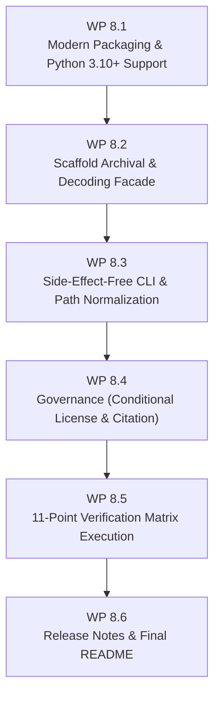

# Phase 8 Implementation Plan: Final Integration, Quality Assurance & Release Planning (Final Refinement)

**Project:** The Five-Head Story-Generation System  
**Document:** `PHASE_8_IMPLEMENTATION_PLAN.md`  
**Phase:** 8 — Final Integration, Quality Assurance & Release Planning  
**Status:** REVISED PROPOSAL — AWAITING AUTHORIZATION (Planning and Documentation ONLY)  
**Date of Technical Refinement:** 2026-11-24  
**Implementation Authorization:** NOT GRANTED (Implementation Has NOT Started)  

---

## 1. Executive Summary & Audit Acceptance

The repository audit conducted in Phase 8 has been accepted in principle. The Five-Head Story-Generation System is technically sound, mathematically verified, and performs cleanly across all seven completed phases:
- **Phases 1–3:** Established the canonical 34-sentence corpus, 120-token vocabulary, word-level tokenization, maximum likelihood estimation (MLE) unigram/bigram/trigram models, probability smoothing (Laplace, Add-$k$, Good-Turing, Backoff, Interpolation), and decoders (Greedy, Top-$k$, Temperature).
- **Phase 4:** Implemented the five transparent scoring heads (**Grammar Scout**, **Character Keeper**, **Setting Painter**, **Action Booster**, **Repeat Blocker**), linear score fusion, and the Hamilton largest-remainder $d10$ apportionment method.
- **Phase 5:** Completed a 1,600-story Monte Carlo benchmark across 8 configurations (200 stories each), tracking 8 automated metrics with 0 failures in 221.02s.
- **Phase 6:** Delivered **The Five-Head Story Studio**, a dark-themed glass-box Streamlit web application.
- **Phase 7:** Delivered the educational Scratch 3.0 project (`five_head_story_machine.sb3`), vector assets, classroom unplugged curriculum, and corrected mathematical score fusion (`forest`: **0.7625**, `castle`: **0.7225**, `garden`: **0.7075**, `ran`: **0.4400**, `Milo`: **0.2375**; Hamilton $d10$: `[4, 2, 1, 1, 2]`).

This revised plan incorporates specific owner directives:
1. **Packaging & Python Compatibility:** Proposed modern Python packaging using `pyproject.toml` with setuptools discovery under `src/`. Static AST inspection and dependency wheel audits confirm Python 3.10 compatibility; mandatory runtime execution in a clean Python 3.10 environment is planned in WP 8.5 to confirm runtime support before final release.
2. **Archival over Deletion:** Planned moving historical Phase 1 scaffolding directories (`scratch/`, `unplugged/`, `streamlit_app/`) into `archive/legacy_phase_1_scaffolds/` to preserve historical documentation while cleaning the root namespace.
3. **Preserve `decoding/` as a Facade:** Planned retaining `src/five_head_nlp/decoding/` and `tests/test_decoding/` by re-exporting decoders from `five_head_nlp.prediction`, matching the established facade pattern of `five_head_nlp.ngrams`.
4. **Standardized CLI Execution & Streamlit Wrapper:** Proposed registering four console scripts (`five-head-monte-carlo`, `five-head-scoring`, `five-head-prediction`, `five-head-studio`). Planned strict pre-execution `argparse` handling for side-effect-free `--help` on experiment scripts, and a dedicated CLI entry point (`five_head_nlp.ui.cli:main`) delegating to Streamlit's official CLI interface with full HTTP health and lifecycle verification.
5. **Dynamic Test Reporting:** Planned requiring all 317 baseline tests and all new facade tests to pass, reporting the actual total collected count dynamically with separate accounting of passed, failed, errors, skipped, and xfailed.
6. **Conditional Licensing:** Prepared the MIT License as the proposed option, leaving actual file creation conditional on explicit owner confirmation.
7. **Honest Release Documentation:** Planned clear distinction between implemented, programmatically verified, and manually verified capabilities, explicitly noting that official Scratch 3.0 editor visual execution was not performed.

> [!IMPORTANT]
> **Strict Implementation Terminology:**  
> - **"Implemented"** refers strictly to confirmed, existing code delivered in Phases 1–7.  
> - **"Architecture Reviewed"** refers to system design and static codebase properties evaluated during our audit.  
> - **"Verification Procedure Specified"** refers to testing protocols, commands, and harnesses defined in this plan.  
> - **"Awaiting Runtime Verification"** refers to runtime behaviors (packaging, CLI execution, server lifecycle, port release) awaiting implementation and execution in Work Package 8.5.  
> - **"Proposed / Planned"** refers to architectural designs and tasks assigned to future work packages.  
> **No implementation work has been executed.**

---

## 2. Current Repository Structure

```text
NLP-GAME-PROJECT/
├── .gitignore                             # Git ignore rules for Python, IDE, and test caches
├── README.md                              # Root project overview, architecture, and quickstart
├── app.py                                 # Streamlit application entry point
├── pytest.ini                             # Pytest configuration (pythonpath = src, testpaths = tests)
├── requirements.txt                       # Core dependencies (numpy, pandas, streamlit, matplotlib, pytest)
├── data/
│   ├── raw/
│   │   ├── story_corpus.txt               # Canonical 34-sentence children's story corpus (2,061 B)
│   │   └── corpus_metadata.json           # Raw corpus metadata and SHA-256 provenance (5,045 B)
│   └── processed/
│       ├── tokenized_corpus.json          # Sentence-tokenized corpus (12,240 B)
│       ├── vocabulary.json                # 120-token vocabulary with frequencies (13,036 B)
│       └── word_frequencies.csv           # Tabular frequency counts (1,700 B)
├── docs/
│   ├── architecture.md                    # Core system architecture and component interactions
│   ├── corpus_reconstruction.md           # Phase 1 corpus provenance and validation rules
│   ├── corpus_statistics.md               # Phase 2 exploratory data analysis and token transitions
│   ├── implementation_log.md              # Historical engineering changelog (Phases 1–6)
│   ├── language_model_architecture.md     # Phase 3 language model class specifications
│   ├── mathematical_formulation.md        # Comprehensive mathematical equations (Phases 3–4)
│   ├── phase_5_experimental_methodology.md# 1,600-story Monte Carlo evaluation protocol
│   └── phase_6_application_guide.md       # Streamlit Story Studio usage and component guide
├── experiments/
│   ├── run_monte_carlo.py                 # Phase 5 Monte Carlo generation CLI harness
│   ├── run_five_head_scoring.py           # Phase 4 Head scoring demonstration CLI script
│   ├── run_next_token_prediction.py       # Phase 3.4 Next-token prediction CLI script
│   ├── models/                            # Serialized language models (Unigram, Bigram, Trigram)
│   └── results/
│       ├── corpus_analysis/               # Phase 2 EDA figures and statistics
│       ├── smoothing_analysis/            # Phase 3.3 Smoothing comparison plots and perplexity CSVs
│       ├── next_token_prediction/         # Phase 3.4 Candidate rankings and latency benchmarks
│       ├── five_head_scoring/             # Phase 4 Head rankings, radar charts, and Hamilton allocation
│       └── monte_carlo/                   # Phase 5 artifacts (1,600 JSONL stories, metrics CSVs, 8 plots)
├── phase_7/
│   ├── scratch/
│   │   ├── five_head_story_machine.sb3    # Verified Scratch 3.0 binary ZIP archive
│   │   ├── build_scratch_project.py       # Programmatic vector SVG and AST project builder
│   │   ├── validate_sb3.py                # Automated integrity, checksum, and math validator
│   │   ├── source/project.json            # Human-readable Scratch 3.0 abstract syntax tree
│   │   └── assets/                        # 12 custom Scalable Vector Graphics (SVG)
│   ├── classroom/
│   │   ├── unplugged_activity.md          # 60-minute kinesthetic simulation guide
│   │   ├── teacher_guide.md               # Lesson plan, misconceptions, and grading rubric
│   │   ├── student_worksheet.md           # Printable 6-part student activity worksheet
│   │   └── answer_key.md                  # Teacher answer key with full arithmetic solutions
│   └── documentation/
│       ├── scratch_architecture.md        # Scratch AST target, variable, and broadcast specification
│       ├── mathematical_explanation.md    # Pedagogical bridge: continuous N-gram to linear score fusion
│       ├── testing_report.md              # SB3 validator output and regression test logs
│       └── phase_7_implementation_report.md# Master engineering report for Phase 7
├── src/five_head_nlp/                     # Production Python package (71 modules)
│   ├── __init__.py                        # Top-level package namespace
│   ├── tokenization/                      # CorpusLoader, StoryTokenizer, Vocabulary
│   ├── probability/                       # NGramProbabilityEngine, MLE calculations
│   ├── models/                            # BaseNGramModel, Unigram, Bigram, Trigram
│   ├── smoothing/                         # Laplace, Add-k, Good-Turing, Backoff, Interpolation
│   ├── prediction/                        # NextTokenPredictor, Greedy, Top-k, Temperature decoders
│   ├── heads/                             # The Five Heads, HeadOrchestrator, ScoreFusion, Hamilton
│   ├── experiments/                       # StoryGenerator, GenerationHarness, 8 Automated Metrics
│   ├── evaluation/                        # CorpusStatistics, CorpusPlotter
│   ├── utils/                             # Corpus validation and integrity checks
│   ├── ui/                                # Streamlit Web Application Subsystem
│   ├── decoding/                          # Docstring-only stub (to be enhanced as facade)
│   └── ngrams/                            # Re-export facade from probability.mle
├── tests/                                 # Pytest test suite (317 tests, 100% pass)
│   ├── test_tokenization/                 # 22 tests
│   ├── test_probability/                  # 44 tests
│   ├── test_models/                       # 36 tests
│   ├── test_smoothing/                    # 58 tests
│   ├── test_prediction/                   # 38 tests
│   ├── test_heads/                        # 42 tests
│   ├── test_experiments/                  # 35 tests
│   ├── test_evaluation/                   # 1 test
│   ├── test_ui/                           # 41 tests (including headless Streamlit AppTest)
│   ├── test_corpus_validation.py          # Corpus integrity tests
│   ├── test_ngrams/                       # 1 re-export test
│   └── test_decoding/                     # Empty stub directory (to test decoding facade)
├── scratch/                               # Phase 1 scaffold README (to move to archive/)
├── unplugged/                             # Phase 1 scaffold with empty directories (to move to archive/)
└── streamlit_app/                         # Phase 1 empty __init__.py (to move to archive/)
```

---

## 3. Resolution of Technical Review Points

### Point 1: Python Version Compatibility & Runtime Verification Strategy

#### A. Static Audit Findings:
1. **Abstract Syntax Tree (AST) Parsing:**
   - Executed `ast.parse()` across all Python source files in `src/`, `tests/`, and `experiments/`.
   - Verified result: **0 syntax errors** under Python 3.10 parsing rules.
2. **Language and Standard Library Features:**
   - All modules declare `from __future__ import annotations` (PEP 563).
   - Type annotations use built-in generics `list[...]`, `dict[...]` (PEP 585) and union operator `X | Y` (PEP 604), all standard in Python 3.10.
   - Verified that no Python 3.11-specific features are referenced (0 occurrences of `ExceptionGroup`, `typing.Self`, `BaseException.add_note()`, or `tomllib`).
3. **Dependency Wheel Availability:**
   - Verified PyPI wheel availability for Python 3.10: `numpy` (1.24.0–1.26.4), `pandas` (2.0.0+), `streamlit` (1.30.0+), `matplotlib` (3.7.0+), `pytest`, and `pytest-cov`.

#### B. Runtime Verification Protocol in WP 8.5:
Static parsing alone does not guarantee runtime execution. Therefore, the implementation plan requires:
1. Provisioning a clean virtual environment using Python 3.10.
2. Executing `pip install -r requirements.txt` and `pip install -e .`.
3. Running the complete regression test suite (`pytest tests -q`).
4. Running the packaging and CLI verification commands.
5. Recording and reporting the exact Python minor version, installation results, test counts, failures, and warnings.
6. **Conditional Retention:** If Python 3.10 runtime verification succeeds, retain `requires-python = ">=3.10"`. If runtime testing reveals an unexpected incompatibility, document the exact failure and adjust `requires-python` accordingly.

---

### Point 2: Proposed CLI Packaging Architecture & Streamlit Launch Strategy

The system requires standardized command-line accessibility across both the analytical experiment suite and the Streamlit web studio.

#### A. Proposed Experiment CLI Architecture:
The three experiment scripts are:
- `experiments/run_monte_carlo.py`
- `experiments/run_five_head_scoring.py`
- `experiments/run_next_token_prediction.py`

To make these scripts reliably accessible after installation without relying on working directory assumptions:
1. **Proposed Entry Points:** Plan creation of dedicated CLI entry-point functions inside the package:
   - `five_head_nlp.experiments.cli_monte_carlo:main`
   - `five_head_nlp.experiments.cli_scoring:main`
   - `five_head_nlp.experiments.cli_prediction:main`
2. **Repository Wrappers:** Planned keeping the scripts in `experiments/` as thin wrappers that invoke these entry points, maintaining backward compatibility for existing workflows.
3. **Path Resolution:** `CorpusLoader` resolves its default path relative to package location via `Path(__file__).resolve().parents[3] / "data" / "raw" / "story_corpus.txt"`. Verified via test in `tempfile.TemporaryDirectory()` that `CorpusLoader` loads the 34 sentences correctly when executed from an unrelated working directory.

#### B. Streamlit Console Entry-Point Analysis & Supported Launch Architecture:

1. **Technical Limitation of Direct `application:main` Registration:**
   - In previous planning, the proposed entry point was `five-head-studio = "five_head_nlp.ui.application:main"`.
   - **Architectural Failure:** `application.py` is an imperative Streamlit application script containing direct calls to `st.set_page_config()`, `st.sidebar`, and rendering components. When a standard Python console script executes `application:main`, it runs in the main Python thread outside the Streamlit execution runtime (`ScriptRunContext`, Tornado HTTP server, WebSocket handler, and SessionState proxy).
   - **Observed Direct-Execution Failure:** Running `application:main` directly in bare Python produces runtime warnings (`Thread 'MainThread': missing ScriptRunContext!`, `Session state does not function when running a script without streamlit run`), binds **no** network port, starts **no** HTTP server, and immediately exits. It does **not** launch a functional application.
   - **Why `AppTest` Did Not Catch This:** `AppTest.from_file()` in `tests/test_ui/` runs an in-memory synthetic execution harness. It tests UI element creation, state dictionaries, and widget logic in Python memory. It does **not** test console script execution, OS process spawning, CLI argument parsing, Tornado server initialization, network socket binding, or HTTP response handling. Relying on `AppTest` to prove console-script functionality was a false equivalence.

2. **Supported Launch Architecture (`five_head_nlp.ui.cli:main`):**
   - Plan creation of a dedicated entry-point module: `src/five_head_nlp/ui/cli.py`.
   - **Launch Mechanism:** Use Streamlit's official and supported CLI interface: `from streamlit.web import cli as stcli`.
   - **Relative Path Resolution:** Dynamically locate `application.py` relative to `cli.py`:
     ```python
     app_path = Path(__file__).resolve().parent / "application.py"
     ```
     Because `cli.py` and `application.py` are co-located in `src/five_head_nlp/ui/`, this path resolution works identically in development, editable installs (`pip install -e .`), and standard wheel installs.
   - **Argument Forwarding & Single-Process Execution:**
     ```python
     def main() -> None:
         """Launch The Five-Head Story Studio web application via Streamlit CLI."""
         import sys
         from pathlib import Path
         from streamlit.web import cli as stcli

         app_path = Path(__file__).resolve().parent / "application.py"
         sys.argv = ["streamlit", "run", str(app_path)] + sys.argv[1:]
         sys.exit(stcli.main())
     ```
   - **Key Advantages:**
     - Runs as a single process (the console script becomes the Streamlit server process), preventing orphaned child processes.
     - Fully forwards native Streamlit flags (e.g. `--server.port`, `--server.headless`, `--browser.serverAddress`).
     - Preserves standard OS signal handling: Streamlit's runtime registers signal handlers for `SIGINT`, `SIGTERM` (and `SIGBREAK` on Windows via `_set_up_signal_handler`), enabling graceful shutdown of the Tornado event loop, WebSocket connections, and server runtime, and orderly socket release upon receiving console interrupt or termination signals.
     - Does not invent private or unsupported APIs (uses public `streamlit.web.cli.main`).

3. **Cross-Platform Process Group Control, Decoupled Observation, Exception-Safe Shutdown & Verification Contract:**
   - **Windows Console Control Event Prerequisites & Delivery:** Under the Win32 API, `GenerateConsoleCtrlEvent(CTRL_BREAK_EVENT, dwProcessGroupId)` delivers an interrupt signal only if:
     1. The target process was spawned with the `CREATE_NEW_PROCESS_GROUP` flag (`0x00000200`).
     2. `dwProcessGroupId` matches the process group ID (which equals the root process PID).
     3. The caller and target process share an active console session. If a child process is spawned with `DETACHED_PROCESS` or `CREATE_NO_WINDOW`, `GenerateConsoleCtrlEvent` cannot deliver signals.
     Standard PowerShell `Start-Process` does not expose `CREATE_NEW_PROCESS_GROUP` or console attachment configuration; calling `GenerateConsoleCtrlEvent` from an arbitrary PowerShell session without these conditions is unreliable and can fail with `ERROR_INVALID_HANDLE` or signal the host console itself. Furthermore, sending a control event does not guarantee termination (e.g. if an uncooperative or blocking process ignores the interrupt). To establish these required conditions deterministically, a **dedicated Python subprocess verification harness** (`tests/test_ui/verify_studio_lifecycle.py`) is specified for WP 8.5. In Python, `subprocess.Popen(..., creationflags=subprocess.CREATE_NEW_PROCESS_GROUP)` and `proc.send_signal(signal.CTRL_BREAK_EVENT)` deterministically fulfill all Win32 API prerequisites, while enforcing a wall-clock timeout and fallback.
   - **Linux Dedicated Process-Group Management & Boundary Guarantees:** In POSIX environments, child processes spawned by Streamlit may not terminate if signals are sent only to the root PID (`kill -SIGTERM $PID`). The verification harness launches the application in a dedicated session and process group (`start_new_session=True` in Python, invoking `os.setsid()`, or `setsid five-head-studio ... &` in shell). The process group ID (`PGID`) matches the root PID. Signals are broadcast to the entire group (`os.killpg(proc.pid, signal.SIGTERM)` or `kill -SIGTERM -$PGID`).
     - *Guaranteed Scope:* Signals reach all processes that remain members of the dedicated process group. When intermediate processes exit, POSIX re-parenting of children to PID 1 (`init`/`systemd`) does *not* alter their process group ID; group signaling still reaches re-parented children.
     - *Escape Boundary & Best-Effort Detection:* Descendants that deliberately invoke `setsid()` or `setpgid()` escape the session process group. The harness detects such escaping processes on a best-effort basis by continuously recording `(pid, create_time)` identities via `psutil` every 250–500 ms throughout the startup and observation windows. If discovered before detachment, they are targeted individually via `psutil.Process(pid).kill()`. Descendants that detach prior to discovery cannot be group-signaled or tracked; unconditional termination of all descendants is not claimed.
   - **Decoupled Process-Observation Window & Process vs Thread Scope:** Process-tree tracking and health polling are strictly decoupled activities. Exiting the observation loop as soon as health returns HTTP 200 defeats continuous descendant tracking. The harness enforces three distinct, separately configured durations:
     1. `startup_timeout_seconds` (15.0s): Maximum time allowed for initial HTTP 200 response with body `"ok"` from canonical `/_stcore/health`. If this expires or the process exits early, startup polling terminates and cleanup begins immediately.
     2. `observation_window_seconds` (3.0s): Dedicated post-healthy observation window during which the application runs undisturbed. Descendant discovery queries the process tree iteratively every 250–500 ms. Note: this monitoring tracks operating system *processes* via `psutil`, not individual Python or OS threads. OS threads terminate automatically when their enclosing process terminates; thread-level introspection is explicitly marked out of scope.
     3. `graceful_timeout_seconds` (10.0s): Maximum monotonic duration allowed for graceful termination after signal dispatch before fallback kill is triggered.
   - **Continuous Tree Tracking & Identity Verification:** The harness maintains an accumulator set of process identities: `tracked_processes: set[tuple[int, float]]`. Storing `(pid, create_time)` tuples eliminates PID-reuse errors: recycled PIDs assigned by the OS to subsequent unrelated processes have different creation timestamps and are not falsely flagged as surviving descendants. Processes that terminate or become inaccessible during enumeration are handled cleanly by trapping `psutil.NoSuchProcess` and `psutil.AccessDenied`.
   - **Exception-Safe Shutdown Signaling:** Signal dispatch is fully protected against race conditions and early termination:
     - If the application exits before health check succeeds, the harness detects `proc.poll() is not None`, records `shutdown_signal_sent = False`, captures the exit code, skips signal dispatch, and proceeds directly to cleanup.
     - If the process exits between the state check and signal dispatch, or if the process group vanishes, the harness catches `ProcessLookupError`, `PermissionError`, and `OSError`, records the exception message in `shutdown_signal_error`, and proceeds directly to fallback cleanup. A failed signal attempt never aborts cleanup.
   - **Symmetrical Graceful-First Policy on Normal & Failure Cleanup:** The graceful-first shutdown policy applies uniformly to *both* normal test termination and startup/health-check failures. If a health check fails or times out, the verification harness must not jump to forceful termination; it must first issue `SIGTERM` (POSIX) or `CTRL_BREAK_EVENT` (Windows) to the process group, wait up to 10s for exit, and only escalate to forceful termination (`SIGKILL` / `proc.kill()`) if graceful shutdown times out, with mandatory diagnostic reporting of the fallback.
   - **Rigorous Port Release Verification & Canonical Health Endpoint:**
     1. *Canonical Health Endpoint:* The verification target is `http://127.0.0.1:{port}/_stcore/health`, the canonical endpoint for Streamlit 1.12.0+ (and the project's pinned `streamlit>=1.30.0,<2.0.0`). The test establishes that the responding service is the intended Streamlit application by verifying both HTTP status `200` and response body `"ok"`.
     2. *Pre-launch availability check:* Eliminates `SO_REUSEADDR` to prevent false-positive binds on sockets held in kernel `TIME_WAIT` or shared states. Verifies port is free before launch (`pre_launch_port_free`). If occupied, launch is aborted and reported.
     3. *Post-shutdown release polling:* Polls port availability with a bounded retry interval (up to 3.0s at 0.25s intervals) to allow kernel socket teardown before asserting `post_shutdown_port_free`.
   - **Independent Verdicts: Lifecycle Success vs Scenario Test Verdict:** The test harness strictly distinguishes between two independent verdicts:
     1. `lifecycle_success`: Boolean evaluating whether the application completed its entire production lifecycle cleanly (pre-launch free, health check HTTP 200 with body `"ok"`, observation window completed, graceful shutdown succeeded without fallback, no remaining descendants, and post-shutdown port released).
     2. `scenario_test_passed`: Boolean evaluating whether the verification harness observed the exact expected outcome for the specific scenario (e.g., in failure-injection scenarios such as Startup Timeout, Port Occupied Pre-Launch, or Graceful Fallback, `scenario_test_passed` is `True` because the harness properly caught, diagnosed, and safely cleaned up the injected condition, even though `lifecycle_success` is `False`).
   - **Comprehensive Lifecycle Result Contract:** The test harness returns a structured dataclass (`LifecycleVerificationResult`) reporting 22 distinct outcome metrics, separating:
     1. `app_exit_code`: Numeric return code of the root process.
     2. `expected_exit_status`: Boolean verifying whether exit code matches expected clean shutdown (Windows: `0` or `3221225786` / `0xC000013A`; POSIX: `0`, `130`, `143`).
     3. `graceful_success`: True ONLY if signal was sent, process exited within timeout, exit code was expected, and no fallback was required.
     4. `fallback_required` and `fallback_error`: Detailed accounting of any forceful kill escalation.
     5. `pre_launch_port_free` and `post_shutdown_port_free`: Independent port release metrics.
     6. `remaining_descendants`: Specific list of any surviving tracked child PIDs.
     7. `lifecycle_success` and `failure_reasons`: Explicit production lifecycle health evaluation.
   - **Verification Dependencies:** `psutil>=5.9.0,<7.0.0` is explicitly specified as a planned development dependency in `pyproject.toml` under `[project.optional-dependencies] dev`.
   - **Cross-Platform Fallback Semantics, Windows Job Objects & Residual Limitations:**
     - *POSIX Process Groups:* Broadcasting `SIGKILL` to `-$PGID` provides a kernel guarantee that all processes remaining in the session group are terminated.
     - *Windows Whole-Tree Fallback:* On Windows, `proc.kill()` calls `TerminateProcess` on the root process handle only. The harness explicitly iterates over all discovered `(pid, create_time)` pairs in `tracked_processes` and invokes `kill()` on each child process in leaf-first order.
     - *Windows Job Objects Policy:* Without enclosing the process in a Windows Job Object (`JOB_OBJECT_LIMIT_KILL_ON_JOB_CLOSE`), any grandchild process that broke away before discovery enumeration could theoretically remain detached. For the v1.0.0 release, **Windows Job Objects are explicitly NOT required** as an acceptance gate, avoiding fragile platform-specific C-extensions or external Win32 DLL wrappers. The multi-point `psutil` dynamic tree tracking and leaf-first termination is accepted as the standard release guarantee, and the residual limitation of untracked detached processes on Windows is formally documented and explicitly accepted.
   - **Verification Terminology:** This lifecycle architecture has been reviewed and specified; runtime behavior is awaiting packaging implementation and execution in WP 8.5.

#### C. Proposed Console Scripts in `pyproject.toml`:
```toml
[project.scripts]
five-head-monte-carlo = "five_head_nlp.experiments.cli_monte_carlo:main"
five-head-scoring = "five_head_nlp.experiments.cli_scoring:main"
five-head-prediction = "five_head_nlp.experiments.cli_prediction:main"
five-head-studio = "five_head_nlp.ui.cli:main"
```

#### D. Exact Planned Execution Commands:

| Scenario | Working Directory Context | Planned Command | Expected Behavior |
|---|---|---|---|
| **Scenario A** | Repository Root (`NLP-GAME-PROJECT/`) | `five-head-monte-carlo --help`<br>`five-head-scoring --help`<br>`five-head-prediction --help` | Console scripts invoke entry points; exit 0; zero compute |
| **Scenario A** (Module syntax) | Repository Root (`NLP-GAME-PROJECT/`) | `python -m experiments.run_monte_carlo --help`<br>`python -m experiments.run_five_head_scoring --help`<br>`python -m experiments.run_next_token_prediction --help` | Module execution; exit 0 |
| **Scenario A** (Script syntax) | Repository Root (`NLP-GAME-PROJECT/`) | `python experiments/run_monte_carlo.py --help`<br>`python experiments/run_five_head_scoring.py --help`<br>`python experiments/run_next_token_prediction.py --help` | Wrapper script execution; exit 0 |
| **Scenario B** | Outside Repository (e.g. `cd %TEMP%` or `/tmp`) | `five-head-monte-carlo --help`<br>`five-head-scoring --help`<br>`five-head-prediction --help` | Console script resolved via `PATH`; exit 0; zero compute |
| **Scenario B** (Module syntax) | Outside Repository (e.g. `cd %TEMP%` or `/tmp`) | `python -m five_head_nlp.experiments.cli_monte_carlo --help`<br>`python -m five_head_nlp.experiments.cli_scoring --help`<br>`python -m five_head_nlp.experiments.cli_prediction --help` | Module resolved via installed package; exit 0 |
| **Scenario B** (Web UI) | Outside Repository (e.g. `cd %TEMP%` or `/tmp`) | `five-head-studio` | Launches Streamlit web server on `http://localhost:8501` from any working directory; responds to HTTP health check; shuts down gracefully upon OS interrupt signal |

---

### Point 3: Corrected Test Acceptance Criteria

The baseline regression suite consists of **317 passing tests** across 8 test directories.

The proposed decoding facade in WP 8.2 will add:
- `tests/test_decoding/test_decoding_facade.py`

#### Acceptance Criteria Rules:
1. **Zero Regression:** All **317 original tests** must continue to pass.
2. **Facade Coverage:** All newly added facade tests in `test_decoding_facade.py` must pass.
3. **Dynamic Accounting:** The total number of collected and passed tests will be reported dynamically based on pytest collection:
   $$\text{Total Passed} = 317 + K \quad (K = \text{count of newly added facade tests})$$
   The plan does **not** assume an arbitrary fixed total count in advance.
4. **Separate Categorization:** Test reporting must separate:
   - **Passed:** Actual count ($317 + K$)
   - **Failed:** Must be exactly **0**
   - **Errors:** Must be exactly **0**
   - **Skipped:** Must be exactly **0** (or explicitly justified)
   - **XFailed / XPassed:** Must be exactly **0**
5. **Investigation:** Any regression among the original 317 tests triggers an immediate halt and investigation.

---

### Point 4: Side-Effect-Free CLI Help Specification & Verification

#### Identified Limitation:
`run_five_head_scoring.py` and `run_next_token_prediction.py` currently execute demonstration code immediately inside `main()` without `argparse`. Consequently, running `--help` currently executes the demonstration, initializes models, and writes files.

#### Planned Implementation Requirements (WP 8.3):
1. **Pre-Execution Argument Parsing:** All three scripts/entry points must instantiate `argparse.ArgumentParser` as the first operation inside `main()`.
2. **Help Interception:** Invocations of `--help` or `-h` must display formatted help text and exit with status code 0 immediately.
3. **Zero Computational Side-Effects:**
   - No `CorpusLoader` invocation or file loading during `--help`.
   - No model training or probability smoothing during `--help`.
   - No inference or candidate evaluation during `--help`.
4. **Zero Filesystem Side-Effects:**
   - No directory creation (`experiments/results/...`) during `--help`.
   - No generation or modification of CSV, JSON, PNG, or text files during `--help`.

#### Planned Verification Protocol:
```powershell
# 1. Capture snapshot of results directory before help invocation
$before_count = (Get-ChildItem -Recurse experiments/results).Count

# 2. Invoke help across all three commands
python -m experiments.run_monte_carlo --help
python -m experiments.run_five_head_scoring --help
python -m experiments.run_next_token_prediction --help

# 3. Assert exit code == 0 for each invocation
# 4. Capture snapshot after help invocation and verify zero file changes
$after_count = (Get-ChildItem -Recurse experiments/results).Count
if ($before_count -ne $after_count) { throw "CLI help produced filesystem side effects!" }
```

---

## 4. Historical Scaffolding Archival Strategy (`archive/legacy_phase_1_scaffolds/`)

To preserve historical project documentation without polluting the production namespace:
1. Planned creation of `archive/legacy_phase_1_scaffolds/`.
2. Planned moves:
   - `scratch/` $\to$ `archive/legacy_phase_1_scaffolds/scratch/` (preserves Phase 1 Scratch specification README).
   - `unplugged/` $\to$ `archive/legacy_phase_1_scaffolds/unplugged/` (preserves Phase 1 Unplugged notes and empty scaffolds).
   - `streamlit_app/` $\to$ `archive/legacy_phase_1_scaffolds/streamlit_app/` (preserves Phase 1 Streamlit stub).
3. Planned authoring of `archive/legacy_phase_1_scaffolds/README.md` documenting the provenance of these early files and directing users to production implementations in `phase_7/` and `src/five_head_nlp/ui/`.

---

## 5. Decoding Facade Preservation (`five_head_nlp.decoding`)

To preserve architectural symmetry with `five_head_nlp.ngrams` and prevent breaking backward-compatibility:
1. **Preserve `src/five_head_nlp/decoding/`:** Planned updating `src/five_head_nlp/decoding/__init__.py` to re-export:
   ```python
   """Decoding strategies, temperature scaling, repetition suppression, and sampling."""

   from five_head_nlp.prediction.decoding import (
       BaseDecoder,
       DecodingStrategy,
       GreedyDecoder,
       TemperatureDecoder,
       TopKDecoder,
   )

   __all__ = [
       "BaseDecoder",
       "DecodingStrategy",
       "GreedyDecoder",
       "TemperatureDecoder",
       "TopKDecoder",
   ]
   ```
2. **Activate `tests/test_decoding/`:** Planned authoring `tests/test_decoding/test_decoding_facade.py` testing importability, class identities, and enum membership.

---

## 6. Proposed Packaging Specification (`pyproject.toml`)

```toml
[build-system]
requires = ["setuptools>=61.0", "wheel"]
build-backend = "setuptools.build_meta"

[project]
name = "five-head-nlp"
version = "1.0.0"
description = "A transparent, multi-head story generation system using classical NLP and statistical language models."
readme = "README.md"
requires-python = ">=3.10"
authors = [
    { name = "Five-Head NLP Team" }
]
classifiers = [
    "Programming Language :: Python :: 3",
    "Programming Language :: Python :: 3.10",
    "Programming Language :: Python :: 3.11",
    "Programming Language :: Python :: 3.12",
    "Topic :: Scientific/Engineering :: Artificial Intelligence",
    "Topic :: Education",
    "Intended Audience :: Education",
    "Intended Audience :: Science/Research",
]
dependencies = [
    "numpy>=1.24.0,<2.0.0",
    "pandas>=2.0.0,<3.0.0",
    "streamlit>=1.30.0,<2.0.0",
    "matplotlib>=3.7.0,<4.0.0",
]

[project.optional-dependencies]
dev = [
    "pytest>=7.4.0,<9.0.0",
    "pytest-cov>=4.1.0,<6.0.0",
    "psutil>=5.9.0,<7.0.0",
]

[project.scripts]
five-head-monte-carlo = "five_head_nlp.experiments.cli_monte_carlo:main"
five-head-scoring = "five_head_nlp.experiments.cli_scoring:main"
five-head-prediction = "five_head_nlp.experiments.cli_prediction:main"
five-head-studio = "five_head_nlp.ui.cli:main"

[tool.setuptools.packages.find]
where = ["src"]

[tool.pytest.ini_options]
testpaths = ["tests"]
```

---

## 7. Open-Source Governance & Conditional Licensing Policy

### A. License Decision Status: CONDITIONAL (Pending Owner Confirmation)
- **Proposed Option:** MIT License (permissive open-source license).
- **Draft Prepared:** Standard MIT License text referencing 2026 Five-Head NLP Team.
- **Policy:** **No `LICENSE` file will be created** until explicit written owner approval is provided.

### B. Contributor & Citation Metadata (Unconditional)
- `CONTRIBUTING.md`: Detailed setup instructions, coding conventions, test execution steps, and PR expectations.
- `CITATION.cff`: Standard Citation File Format (CFF v1.2.0) defining authors, title, version 1.0.0, and repository URL.

---

## 8. Expanded 11-Point Quality Assurance & Verification Matrix

| # | Verification Dimension | Target | Exact Command | Success Criteria |
|:---:|---|---|---|---|
| **1** | **Clean Environment Install** | Virtual environment isolation | `python -m venv test_env && .\test_env\Scripts\activate && pip install -r requirements.txt` | Clean pip installation with 0 errors |
| **2** | **Editable Package Install** | Packaging discovery | `pip install -e .` | Successfully registers `five-head-nlp 1.0.0` from `src/` |
| **3** | **Regression Suite** | All unit/integration tests | `pytest tests -q` | All 317 baseline tests + new facade tests pass; 0 failures, 0 errors, 0 skips |
| **4** | **Scenario A CLI Verification** | Root console & module execution | `five-head-monte-carlo --help`<br>`python -m experiments.run_five_head_scoring --help` | All exit code 0; zero compute or artifact modification |
| **5** | **Scenario B CLI Verification** | Remote directory execution | `cd %TEMP% && five-head-monte-carlo --help && five-head-scoring --help && cd -` | Console scripts functional outside repository; exit code 0 |
| **6** | **Console Studio Lifecycle Verification** | Web UI console entry point (`five-head-studio`) | 10-point automated lifecycle verification via `tests/test_ui/verify_studio_lifecycle.py`:<br>1. Confirm `five-head-studio` binary in `PATH` after `pip install -e .`.<br>2. Execute from remote directory (`cd %TEMP%` or `/tmp`) with log capture.<br>3. Verify server startup.<br>4. Poll canonical `/_stcore/health` and assert HTTP 200 with response body 'ok' within 15s (verifying responding service is Streamlit).<br>5. Retain and inspect startup log.<br>6. Continuous dynamic process-tree tracking (recording `(pid, create_time)` identities; threads out of scope).<br>7. Initiate graceful termination via OS signal/console break to dedicated process group.<br>8. Assert process exit within 10s graceful window; capture exit status.<br>9. Verify port release via socket bind without `SO_REUSEADDR`.<br>10. Verify no remaining tracked descendants; report any forceful fallback.<br>*(Apply symmetrical graceful-first policy to startup failures; test invalid option reporting; evaluate scenario_test_passed independently from lifecycle_success).* | All 10 verification dimensions pass: server launches from remote directory, responds HTTP 200 with body 'ok', logs retained, terminates gracefully via process group signal within 10s, port released, tracked descendants verified terminated, separate accounting of scenario_test_passed vs lifecycle_success, and forceful fallback isolated as a reported exception. |
| **7** | **Scratch Project Validation** | Binary `.sb3` ZIP & AST | `python phase_7/scratch/validate_sb3.py` | 100% valid report (12 targets, 4 monitors, 12 MD5 hashes) |
| **8** | **Mathematical Invariants** | Probability, fusion, Hamilton | `validate_sb3.py` & `pytest tests/test_heads tests/test_smoothing` | Probabilities sum to 1.0; weights sum to 1.0; candidate scores match verified table; Hamilton sums to 10 |
| **9** | **Fixed-Seed Reproducibility** | Deterministic rollout | Run generator with seed 42 twice in python | Bitwise identical token sequence generated across runs |
| **10** | **Artifact Consistency** | Phase 5 benchmark records | Match JSONL lines to CSV rows via python check | Exactly 1,600 JSONL records match 1,600 CSV rows |
| **11** | **Machine-Path Scan** | Zero absolute paths | Regex search across `.py`, `.json`, `.md` | Zero occurrences of `C:\`, `/Users/`, or machine paths |

---

## 9. Revised Phase 8 Work Packages (WP 8.1 to WP 8.6)



### WP 8.1: Modern Python Packaging & Python 3.10+ Compatibility
- Author `pyproject.toml` with `requires-python = ">=3.10"`.
- Configure setuptools package discovery pointing to `src/`.
- Register console scripts: `five-head-monte-carlo`, `five-head-scoring`, `five-head-prediction`, and `five-head-studio = "five_head_nlp.ui.cli:main"`.

### WP 8.2: Preserving Historical Scaffolding & Decoding Facade
- Create directory `archive/legacy_phase_1_scaffolds/` and move `scratch/`, `unplugged/`, and `streamlit_app/`.
- Add `archive/legacy_phase_1_scaffolds/README.md`.
- Enhance `src/five_head_nlp/decoding/__init__.py` to re-export decoders from `five_head_nlp.prediction.decoding`.
- Create `tests/test_decoding/test_decoding_facade.py`.

### WP 8.3: Side-Effect-Free CLI Standardization, Web Studio Wrapper & Path Sanitization
- Author planned CLI modules `src/five_head_nlp/experiments/cli_monte_carlo.py`, `cli_scoring.py`, and `cli_prediction.py`.
- Author planned Streamlit entry-point wrapper `src/five_head_nlp/ui/cli.py` delegating to `streamlit.web.cli.main` with single-process execution and CLI argument forwarding.
- Enforce side-effect-free `--help` output with exit code 0 and zero compute/file side-effects across all experiment wrappers.
- Sanitize `experiments/results/corpus_analysis/corpus_statistics.json` line 2 from absolute path to relative `"data/raw/story_corpus.txt"`.

### WP 8.4: Open-Source Governance & Citation
- Prepare `LICENSE` as MIT License (creation conditional on owner approval).
- Create `CONTRIBUTING.md` with development and testing guidelines.
- Create `CITATION.cff` with software metadata.

### WP 8.5: Expanded 11-Point Verification Matrix Execution
- Execute all 11 verification dimensions sequentially, including runtime verification in a clean Python 3.10 virtual environment.
- **Execute 10-Point End-to-End Server Lifecycle Verification (`five-head-studio`):**

  #### A. Complete Canonical Python Verification Harness Specification (`tests/test_ui/verify_studio_lifecycle.py`):
  ```python
  """Complete cross-platform lifecycle verification harness for five-head-studio."""
  from __future__ import annotations

  import dataclasses
  import os
  import signal
  import socket
  import subprocess
  import sys
  import time
  import urllib.request
  from pathlib import Path

  import psutil


  @dataclasses.dataclass
  class LifecycleVerificationResult:
      """Structured result reporting every critical dimension of server lifecycle verification."""
      port: int
      pre_launch_port_free: bool
      root_pid: int | None
      health_check_success: bool
      startup_timed_out: bool
      startup_elapsed_seconds: float
      observation_elapsed_seconds: float
      tracked_processes_count: int
      tracked_pids: list[int]
      shutdown_signal_sent: bool
      shutdown_signal_error: str | None
      graceful_exit_elapsed_seconds: float | None
      graceful_exit_within_timeout: bool
      app_exit_code: int | None
      expected_exit_status: bool
      graceful_success: bool
      fallback_required: bool
      fallback_error: str | None
      post_shutdown_port_free: bool
      remaining_descendants: list[int]
      lifecycle_success: bool
      failure_reasons: list[str]
      startup_log: str


  def is_port_available(port: int, host: str = "127.0.0.1") -> bool:
      """Verify port is completely free by testing whether a TCP socket can bind to it.
      
      Note: SO_REUSEADDR is deliberately omitted to prevent false-positive binds
      on ports held in kernel TIME_WAIT or shared socket states.
      """
      with socket.socket(socket.AF_INET, socket.SOCK_STREAM) as s:
          try:
              s.bind((host, port))
              return True
          except OSError:
              return False


  def poll_port_released(
      port: int,
      host: str = "127.0.0.1",
      timeout_seconds: float = 3.0,
      poll_interval: float = 0.25,
  ) -> bool:
      """Poll port availability with a bounded retry window for kernel socket release."""
      start_time = time.monotonic()
      while time.monotonic() - start_time < timeout_seconds:
          if is_port_available(port, host):
              return True
          time.sleep(poll_interval)
      return is_port_available(port, host)


  def discover_process_tree(root_pid: int) -> set[tuple[int, float]]:
      """Recursively discover root PID and all active descendants as (pid, create_time) tuples.
      
      Tracking create_time eliminates PID-reuse errors: recycled PIDs assigned to
      subsequent unrelated processes will not match the recorded identity.
      """
      discovered: set[tuple[int, float]] = set()
      try:
          parent = psutil.Process(root_pid)
          discovered.add((root_pid, parent.create_time()))
          for child in parent.children(recursive=True):
              try:
                  discovered.add((child.pid, child.create_time()))
              except (psutil.NoSuchProcess, psutil.AccessDenied):
                  continue
      except (psutil.NoSuchProcess, psutil.AccessDenied):
          pass
      return discovered


  def initiate_graceful_signal(
      proc: subprocess.Popen,
      pgid: int | None = None,
  ) -> tuple[bool, str | None]:
      """Send OS-appropriate graceful shutdown signal to the process group in an exception-safe manner."""
      if proc.poll() is not None:
          return False, "Process already exited before signal dispatch"
      try:
          if sys.platform == "win32":
              # Windows: send CTRL_BREAK_EVENT to the process group
              proc.send_signal(signal.CTRL_BREAK_EVENT)
          else:
              # POSIX: send SIGTERM to the dedicated session process group
              target_pgid = pgid if pgid is not None else proc.pid
              os.killpg(target_pgid, signal.SIGTERM)
          return True, None
      except (ProcessLookupError, PermissionError, OSError) as e:
          return False, str(e)


  def execute_fallback_kill(
      proc: subprocess.Popen,
      tracked_processes: set[tuple[int, float]],
      pgid: int | None = None,
  ) -> tuple[bool, str | None]:
      """Forcefully terminate the process group and any remaining tracked descendants."""
      fallback_error: str | None = None
      if sys.platform != "win32" and pgid is not None:
          try:
              os.killpg(pgid, signal.SIGKILL)
          except (ProcessLookupError, PermissionError, OSError) as e:
              fallback_error = str(e)
      else:
          try:
              proc.kill()
          except (ProcessLookupError, PermissionError, OSError) as e:
              fallback_error = str(e)

      for pid, create_time in tracked_processes:
          try:
              p = psutil.Process(pid)
              if abs(p.create_time() - create_time) < 0.1:
                  p.kill()
          except (psutil.NoSuchProcess, psutil.AccessDenied):
              continue
      return True, fallback_error


  def verify_studio_lifecycle(
      port: int = 8598,
      startup_timeout_seconds: float = 15.0,
      observation_window_seconds: float = 3.0,
      graceful_timeout_seconds: float = 10.0,
  ) -> LifecycleVerificationResult:
      """Execute end-to-end server lifecycle verification with decoupled observation and strict contracts."""
      failure_reasons: list[str] = []

      # Step 1: Pre-launch port-availability check
      pre_launch_port_free = is_port_available(port)
      if not pre_launch_port_free:
          failure_reasons.append(f"Port {port} is occupied before launch.")
          return LifecycleVerificationResult(
              port=port,
              pre_launch_port_free=False,
              root_pid=None,
              health_check_success=False,
              startup_timed_out=False,
              startup_elapsed_seconds=0.0,
              observation_elapsed_seconds=0.0,
              tracked_processes_count=0,
              tracked_pids=[],
              shutdown_signal_sent=False,
              shutdown_signal_error=None,
              graceful_exit_elapsed_seconds=None,
              graceful_exit_within_timeout=False,
              app_exit_code=None,
              expected_exit_status=False,
              graceful_success=False,
              fallback_required=False,
              fallback_error=None,
              post_shutdown_port_free=False,
              remaining_descendants=[],
              lifecycle_success=False,
              failure_reasons=failure_reasons,
              startup_log="Launch aborted: pre-launch port conflict detected.",
          )

      log_path = Path(os.environ.get("TEMP", "/tmp")) / "studio_startup.log"
      creation_flags = subprocess.CREATE_NEW_PROCESS_GROUP if sys.platform == "win32" else 0
      start_new_session = (sys.platform != "win32")

      with open(log_path, "w", encoding="utf-8") as log_file:
          proc = subprocess.Popen(
              ["five-head-studio", "--server.headless=true", f"--server.port={port}"],
              stdout=log_file,
              stderr=subprocess.STDOUT,
              creationflags=creation_flags,
              start_new_session=start_new_session,
              text=True,
          )

      root_pid = proc.pid
      pgid = root_pid if sys.platform != "win32" else None
      tracked_processes: set[tuple[int, float]] = set()

      # Step 2: Health check polling loop (up to startup_timeout_seconds)
      startup_start = time.monotonic()
      health_check_success = False
      startup_timed_out = False

      while time.monotonic() - startup_start < startup_timeout_seconds:
          time.sleep(0.5)
          tracked_processes.update(discover_process_tree(root_pid))
          if proc.poll() is not None:
              break
          try:
              with urllib.request.urlopen(f"http://127.0.0.1:{port}/_stcore/health", timeout=1) as resp:
                  body = resp.read().decode("utf-8").strip()
                  if resp.status == 200 and body == "ok":
                      health_check_success = True
                      break
          except Exception:
              pass

      startup_elapsed = time.monotonic() - startup_start
      if not health_check_success and proc.poll() is None:
          startup_timed_out = True
          failure_reasons.append("Startup health check timed out after 15 seconds.")

      # Step 3: Decoupled post-healthy observation window (3.0s continuous process-tree tracking; threads out of scope)
      obs_start = time.monotonic()
      if health_check_success and proc.poll() is None:
          while time.monotonic() - obs_start < observation_window_seconds:
              time.sleep(0.5)
              tracked_processes.update(discover_process_tree(root_pid))
              if proc.poll() is not None:
                  break
      observation_elapsed = time.monotonic() - obs_start

      # Step 4: Symmetrical Graceful-First Shutdown (applies to both normal exit and startup timeout)
      shutdown_signal_sent, shutdown_signal_error = initiate_graceful_signal(proc, pgid)
      if shutdown_signal_error:
          failure_reasons.append(f"Shutdown signal error: {shutdown_signal_error}")

      # Step 5: Graceful exit waiting loop (up to graceful_timeout_seconds)
      grace_start = time.monotonic()
      graceful_exit_within_timeout = False
      fallback_required = False
      fallback_error = None

      while time.monotonic() - grace_start < graceful_timeout_seconds:
          if proc.poll() is not None:
              graceful_exit_within_timeout = True
              break
          time.sleep(0.2)

      graceful_exit_elapsed = time.monotonic() - grace_start

      # Step 6: Fallback kill if graceful timeout expired
      if not graceful_exit_within_timeout:
          fallback_required = True
          failure_reasons.append(f"Graceful shutdown timed out after {graceful_timeout_seconds}s; fallback kill required.")
          _, fallback_error = execute_fallback_kill(proc, tracked_processes, pgid)
          try:
              proc.wait(timeout=5.0)
          except (subprocess.TimeoutExpired, OSError) as e:
              if not fallback_error:
                  fallback_error = str(e)

      app_exit_code = proc.returncode

      # Step 7: Expected exit status check
      if sys.platform == "win32":
          expected_exit_status = (app_exit_code in (0, 3221225786))
      else:
          expected_exit_status = (app_exit_code in (0, 130, 143))

      if not expected_exit_status:
          failure_reasons.append(f"Unexpected exit code: {app_exit_code}")

      graceful_success = (
          shutdown_signal_sent
          and graceful_exit_within_timeout
          and expected_exit_status
          and not fallback_required
      )

      # Step 8: Bounded post-shutdown port release verification (polls up to 3.0s)
      post_shutdown_port_free = poll_port_released(port, timeout_seconds=3.0)
      if not post_shutdown_port_free:
          failure_reasons.append(f"Port {port} remains occupied after server shutdown.")

      # Step 9: Verify no remaining descendants from tracked accumulator
      remaining_descendants: list[int] = []
      for pid, ctime in tracked_processes:
          if pid == root_pid:
              continue
          try:
              p = psutil.Process(pid)
              if abs(p.create_time() - ctime) < 0.1:
                  remaining_descendants.append(pid)
          except (psutil.NoSuchProcess, psutil.AccessDenied):
              continue

      if remaining_descendants:
          failure_reasons.append(f"Tracked descendant processes remained alive: {remaining_descendants}")

      with open(log_path, "r", encoding="utf-8") as f:
          startup_log = f.read()

      lifecycle_success = (
          pre_launch_port_free
          and health_check_success
          and not startup_timed_out
          and shutdown_signal_sent
          and graceful_exit_within_timeout
          and expected_exit_status
          and not fallback_required
          and post_shutdown_port_free
          and len(remaining_descendants) == 0
      )

      return LifecycleVerificationResult(
          port=port,
          pre_launch_port_free=pre_launch_port_free,
          root_pid=root_pid,
          health_check_success=health_check_success,
          startup_timed_out=startup_timed_out,
          startup_elapsed_seconds=startup_elapsed,
          observation_elapsed_seconds=observation_elapsed,
          tracked_processes_count=len(tracked_processes),
          tracked_pids=[pid for pid, _ in sorted(tracked_processes)],
          shutdown_signal_sent=shutdown_signal_sent,
          shutdown_signal_error=shutdown_signal_error,
          graceful_exit_elapsed_seconds=graceful_exit_elapsed,
          graceful_exit_within_timeout=graceful_exit_within_timeout,
          app_exit_code=app_exit_code,
          expected_exit_status=expected_exit_status,
          graceful_success=graceful_success,
          fallback_required=fallback_required,
          fallback_error=fallback_error,
          post_shutdown_port_free=post_shutdown_port_free,
          remaining_descendants=remaining_descendants,
          lifecycle_success=lifecycle_success,
          failure_reasons=failure_reasons,
          startup_log=startup_log,
      )


  def evaluate_scenario_assertions(
      scenario_id: int,
      result: LifecycleVerificationResult,
  ) -> tuple[bool, list[str]]:
      """Evaluate scenario-specific assertions independently from overall lifecycle success.

      Returns:
          (scenario_test_passed, assertion_errors)
      """
      errors: list[str] = []

      if scenario_id == 1:
          # Scenario 1: Normal Clean Lifecycle
          if not result.lifecycle_success:
              errors.append(f"Expected lifecycle_success=True, got False. Reasons: {result.failure_reasons}")
          if not result.graceful_success:
              errors.append("Expected graceful_success=True.")
          if result.fallback_required:
              errors.append("Expected fallback_required=False.")

      elif scenario_id == 2:
          # Scenario 2: Startup Timeout
          if result.lifecycle_success:
              errors.append("Expected lifecycle_success=False for startup timeout.")
          if not result.startup_timed_out:
              errors.append("Expected startup_timed_out=True.")
          if result.health_check_success:
              errors.append("Expected health_check_success=False.")
          if not result.shutdown_signal_sent:
              errors.append("Expected shutdown_signal_sent=True (symmetrical graceful cleanup).")
          if not result.post_shutdown_port_free:
              errors.append("Expected post_shutdown_port_free=True.")
          if len(result.remaining_descendants) > 0:
              errors.append(f"Expected remaining_descendants=[], got {result.remaining_descendants}.")

      elif scenario_id == 3:
          # Scenario 3: Early Application Exit
          if result.lifecycle_success:
              errors.append("Expected lifecycle_success=False for early application exit.")
          if result.health_check_success:
              errors.append("Expected health_check_success=False.")
          if result.shutdown_signal_sent:
              errors.append("Expected shutdown_signal_sent=False (process already dead).")
          if result.app_exit_code == 0:
              errors.append("Expected non-zero app_exit_code.")
          if not result.post_shutdown_port_free:
              errors.append("Expected post_shutdown_port_free=True.")

      elif scenario_id == 4:
          # Scenario 4: Graceful Timeout Fallback
          if result.lifecycle_success:
              errors.append("Expected lifecycle_success=False when fallback kill is required.")
          if not result.shutdown_signal_sent:
              errors.append("Expected shutdown_signal_sent=True.")
          if result.graceful_exit_within_timeout:
              errors.append("Expected graceful_exit_within_timeout=False.")
          if not result.fallback_required:
              errors.append("Expected fallback_required=True.")
          if not result.post_shutdown_port_free:
              errors.append("Expected post_shutdown_port_free=True after fallback kill.")
          if len(result.remaining_descendants) > 0:
              errors.append(f"Expected remaining_descendants=[], got {result.remaining_descendants}.")

      elif scenario_id == 5:
          # Scenario 5: Signal Dispatch Failure
          if result.lifecycle_success:
              errors.append("Expected lifecycle_success=False for signal dispatch failure.")
          if result.shutdown_signal_sent:
              errors.append("Expected shutdown_signal_sent=False.")
          if result.shutdown_signal_error is None:
              errors.append("Expected shutdown_signal_error to capture the exception.")
          if not result.post_shutdown_port_free:
              errors.append("Expected post_shutdown_port_free=True.")

      elif scenario_id == 6:
          # Scenario 6: Port Occupied Before Launch
          if result.lifecycle_success:
              errors.append("Expected lifecycle_success=False when pre-launch port is occupied.")
          if result.pre_launch_port_free:
              errors.append("Expected pre_launch_port_free=False.")
          if result.root_pid is not None:
              errors.append(f"Expected root_pid=None (launch aborted), got {result.root_pid}.")

      elif scenario_id == 7:
          # Scenario 7: Descendant Survives Root Graceful Exit
          if result.lifecycle_success:
              errors.append("Expected lifecycle_success=False when descendant survives root exit.")
          if len(result.tracked_pids) == 0:
              errors.append("Expected tracked_pids to include spawned child.")
          if not result.post_shutdown_port_free:
              errors.append("Expected post_shutdown_port_free=True.")

      elif scenario_id == 8:
          # Scenario 8: Port Remains Occupied Post-Shutdown
          if result.lifecycle_success:
              errors.append("Expected lifecycle_success=False when post-shutdown port is occupied.")
          if result.post_shutdown_port_free:
              errors.append("Expected post_shutdown_port_free=False.")

      else:
          errors.append(f"Unknown scenario_id: {scenario_id}")

      scenario_test_passed = (len(errors) == 0)
      return scenario_test_passed, errors
  ```

  #### B. Linux Dedicated Process-Group Bash Procedure:
  ```bash
  #!/usr/bin/env bash
  set -uo pipefail

  LOG_PATH="/tmp/studio_startup.log"
  PORT=8598

  # Step 1: Pre-launch port check
  if ss -tulpn | grep -q ":$PORT "; then
      echo "ERROR: Port $PORT is occupied before launch!"
      exit 1
  fi

  # Step 2: Launch application in a dedicated session and process group
  setsid five-head-studio --server.headless=true --server.port="$PORT" > "$LOG_PATH" 2>&1 &
  ROOT_PID=$!
  PGID=$ROOT_PID
  echo "Launched five-head-studio with root PID: $ROOT_PID (PGID: $PGID)"

  # Continuous process tree tracking accumulator
  TRACKED_PIDS="$ROOT_PID"

  cleanup_process_group() {
      local reason="$1"
      echo "Initiating graceful process-group shutdown (Reason: $reason)..."
      
      # Send SIGTERM to the entire dedicated process group
      kill -SIGTERM -"$PGID" 2>/dev/null || true
      
      # Await exit within 10-second timeout
      local exited=0
      for i in {1..20}; do
          if ! kill -0 "$ROOT_PID" 2>/dev/null; then
              exited=1
              break
          fi
          sleep 0.5
      done
      
      if [ $exited -eq 1 ]; then
          GRACEFUL_SUCCESS=true
          FALLBACK_REQUIRED=false
          wait "$ROOT_PID" 2>/dev/null
          APP_EXIT_CODE=$?
          echo "Root process exited gracefully with status: $APP_EXIT_CODE"
      else
          GRACEFUL_SUCCESS=false
          FALLBACK_REQUIRED=true
          echo "WARNING: Graceful shutdown timed out after 10s! Executing fallback kill -9 on PGID: $PGID..."
          kill -SIGKILL -"$PGID" 2>/dev/null || true
          wait "$ROOT_PID" 2>/dev/null
          APP_EXIT_CODE=$?
          echo "Root process forcefully terminated with status: $APP_EXIT_CODE"
      fi
      
      # Verify port release independently with bounded retry
      local port_free=0
      for i in {1..12}; do
          if ! ss -tulpn | grep -q ":$PORT "; then
              port_free=1
              break
          fi
          sleep 0.25
      done
      
      if [ $port_free -eq 1 ]; then
          PORT_RELEASED=true
          echo "Port $PORT released successfully."
      else
          PORT_RELEASED=false
          echo "ERROR: Port $PORT remains occupied!"
      fi
      
      # Verify remaining descendants specifically from the tracked tree
      REMAINING_DESCENDANTS=()
      for pid in $TRACKED_PIDS; do
          if [ "$pid" != "$ROOT_PID" ] && kill -0 "$pid" 2>/dev/null; then
              REMAINING_DESCENDANTS+=("$pid")
          fi
      done
      
      echo "=== Lifecycle Verification Report ==="
      echo "Application Exit Code: $APP_EXIT_CODE"
      echo "Graceful Shutdown Success: $GRACEFUL_SUCCESS"
      echo "Forceful Fallback Required: $FALLBACK_REQUIRED"
      echo "Port Released: $PORT_RELEASED"
      echo "Remaining Descendants: ${#REMAINING_DESCENDANTS[@]}"
  }

  # Step 3: Health check polling loop (up to 15s) with continuous tree tracking
  healthy=0
  for i in {1..30}; do
      sleep 0.5
      CHILDREN=$(pgrep -P "$ROOT_PID" 2>/dev/null || true)
      for c in $CHILDREN; do
          if [[ ! " $TRACKED_PIDS " =~ " $c " ]]; then
              TRACKED_PIDS="$TRACKED_PIDS $c"
          fi
      done
      
      if [ $healthy -eq 0 ]; then
          HEALTH_BODY=$(curl --fail --silent --max-time 1 "http://127.0.0.1:$PORT/_stcore/health" || true)
          if [ "$HEALTH_BODY" = "ok" ]; then
              healthy=1
              echo "Health check passed: Streamlit /_stcore/health returned HTTP 200 OK ('ok')."
              break
          fi
      fi
  done

  # Step 4: Dedicated post-healthy observation window (3.0s)
  if [ $healthy -eq 1 ]; then
      for i in {1..6}; do
          sleep 0.5
          CHILDREN=$(pgrep -P "$ROOT_PID" 2>/dev/null || true)
          for c in $CHILDREN; do
              if [[ ! " $TRACKED_PIDS " =~ " $c " ]]; then
                  TRACKED_PIDS="$TRACKED_PIDS $c"
              fi
          done
      done
      cleanup_process_group "Health Check Succeeded & Observation Complete"
  else
      echo "Health check failed or timed out!"
      cleanup_process_group "Health Check Failure"
      exit 1
  fi
  ```

  #### C. The 10-Point Independent Verification Criteria:
  1. **Binary Availability:** `five-head-studio` resolvable in system `PATH` following editable installation.
  2. **Remote Execution Context:** Launched from outside the repository (`cd %TEMP%` or `/tmp`).
  3. **Server Initialization:** Streamlit server boots and binds configured test port (e.g. 8598).
  4. **Health Endpoint Verification:** HTTP GET to canonical `http://127.0.0.1:8598/_stcore/health` returns HTTP 200 OK with body `"ok"` within 15 seconds, verifying that the responding service is the intended Streamlit application.
  5. **Startup Log Retention:** Output captures server URL, network addresses, and startup messages.
  6. **Graceful Shutdown Initiation:** OS signal / console break dispatched to dedicated process group (`CTRL_BREAK_EVENT` on Windows; `SIGTERM` on POSIX).
  7. **Process Exit Timing:** Process terminates cleanly within the 10-second graceful timeout window.
  8. **Port Release:** TCP socket can bind immediately to the test port without `SO_REUSEADDR`, confirming kernel socket release.
  9. **No Remaining Descendants:** All dynamically tracked `(pid, create_time)` descendant identities confirmed terminated.
  10. **Separate Outcome Reporting:** Independent accounting of `scenario_test_passed`, `lifecycle_success`, `app_exit_code`, `expected_exit_status`, `graceful_success`, `fallback_required`, `pre_launch_port_free`, `post_shutdown_port_free`, and `remaining_descendants`.
  - **Startup Failure Handling:** Execute `five-head-studio --invalid-option`; verify clean exit with status code 2 and descriptive error output without hanging.
  - **Platform Cleanup Guarantees & Documented Limitations:**
    - *POSIX Guaranteed Behavior:* Signals (`SIGTERM` / `SIGKILL`) sent to `-PGID` terminate all processes that remain members of the dedicated session process group (`start_new_session=True` / `setsid()`). Re-parenting of children to PID 1 (`init`/`systemd`) upon intermediate parent exit does *not* remove a child from its process group; group signaling still reaches re-parented children.
    - *POSIX Best-Effort Detection & Limitations:* Descendants that deliberately invoke `setsid()` or `setpgid()` escape the session process group. The harness detects such escaping processes on a best-effort basis by continuously recording `(pid, create_time)` identities via `psutil` every 250–500 ms throughout startup and observation. If discovered before detachment, they are killed individually via `psutil.Process(pid).kill()`. Descendants that detach prior to discovery cannot be group-signaled; unconditional termination of all descendants is not claimed.
    - *Windows Guaranteed Behavior:* `GenerateConsoleCtrlEvent(CTRL_BREAK_EVENT, proc.pid)` broadcasts the interrupt to all processes sharing the console process group created with `CREATE_NEW_PROCESS_GROUP`.
    - *Windows Best-Effort Whole-Tree Termination:* Standard Win32 `proc.kill()` (`TerminateProcess`) terminates ONLY the root process. Whole-tree cleanup of descendants is performed on a best-effort basis by querying `psutil.Process.children(recursive=True)` and terminating tracked `(pid, create_time)` identities in leaf-to-root order.
    - *Windows Job Objects Policy:* Without enclosing the process in a Windows Job Object (`JOB_OBJECT_LIMIT_KILL_ON_JOB_CLOSE`), any grandchild process that broke away before discovery enumeration could theoretically remain detached. For the v1.0.0 release, **Windows Job Objects are explicitly NOT required** as an acceptance gate. The multi-point `psutil` dynamic tree tracking and leaf-first termination is accepted as the standard release guarantee, and the residual limitation of untracked detached processes on Windows is formally documented and explicitly accepted.
    - *Process vs Thread Monitoring Scope:* The harness monitors operating system *processes* via `psutil`, not individual Python or OS threads. Thread-level inspection is explicitly out of scope because all threads in a process terminate automatically when the enclosing process is terminated by the OS.
    - *PID Recycling:* Rapid OS PID recycling is mitigated by comparing process `create_time` and verifying socket release on the target port as an independent kernel-level invariant.
  - **Verification Status Terminology:** This lifecycle protocol has been reviewed and specified in detail; runtime behavior is awaiting packaging implementation and execution in WP 8.5.

  #### D. Explicit Lifecycle Test Scenarios & Injected Failure Handling:
  The verification suite in `tests/test_ui/verify_studio_lifecycle.py` must execute and report against 8 specific scenarios, strictly separating `scenario_test_passed` (did the test observe the expected scenario outcome?) from `lifecycle_success` (did the application complete a clean production lifecycle?):

  | Scenario | Purpose & Injected Condition | Safe Setup & Teardown Protocol | `scenario_test_passed` | `lifecycle_success` | Mandatory Scenario Assertions |
  |---|---|---|:---:|:---:|---|
  | **Scenario 1: Normal Lifecycle** | Standard clean launch, health check, observation, graceful shutdown. | Clean launch on port 8598; standard test teardown. | **`True`** | **`True`** | `pre_launch_port_free == True`<br>`health_check_success == True`<br>`startup_timed_out == False`<br>`shutdown_signal_sent == True`<br>`graceful_exit_within_timeout == True`<br>`graceful_success == True`<br>`fallback_required == False`<br>`post_shutdown_port_free == True`<br>`len(remaining_descendants) == 0`<br>`lifecycle_success == True` |
  | **Scenario 2: Startup Timeout** | Server fails to respond on health endpoint within 15.0s. | Launch with mock target withholding HTTP 200 response > 15s. Symmetrical graceful-first cleanup terminates process. | **`True`** | **`False`** | `pre_launch_port_free == True`<br>`health_check_success == False`<br>`startup_timed_out == True`<br>`shutdown_signal_sent == True`<br>`post_shutdown_port_free == True`<br>`len(remaining_descendants) == 0`<br>`lifecycle_success == False`<br>`"Startup health check timed out" in failure_reasons` |
  | **Scenario 3: Early Application Exit** | Process crashes or exits before health check succeeds. | Launch with invalid CLI flag (`--invalid-startup-flag`). | **`True`** | **`False`** | `pre_launch_port_free == True`<br>`health_check_success == False`<br>`startup_timed_out == False`<br>`shutdown_signal_sent == False`<br>`app_exit_code != 0`<br>`post_shutdown_port_free == True`<br>`len(remaining_descendants) == 0`<br>`lifecycle_success == False` |
  | **Scenario 4: Graceful Timeout Fallback** | Process ignores graceful signal or blocks during teardown. | Simulated target ignoring SIGTERM / CTRL_BREAK_EVENT with signal ignore handler. Test waits 10.0s, triggers fallback kill. | **`True`** | **`False`** | `shutdown_signal_sent == True`<br>`graceful_exit_within_timeout == False`<br>`graceful_success == False`<br>`fallback_required == True`<br>`post_shutdown_port_free == True`<br>`len(remaining_descendants) == 0`<br>`lifecycle_success == False` |
  | **Scenario 5: Signal Dispatch Failure** | Target process group terminates immediately before signal dispatch. | Target process abruptly killed immediately prior to signal call. Harness catches `ProcessLookupError`. | **`True`** | **`False`** | `shutdown_signal_sent == False`<br>`shutdown_signal_error is not None`<br>`post_shutdown_port_free == True`<br>`lifecycle_success == False`<br>Harness does not raise uncaught exception |
  | **Scenario 6: Port Occupied Before Launch** | Collision with existing bound port before application launch. | Python `with socket.socket() as s:` binds port 8598 and listens. Harness pre-checks port and aborts launch. Context manager closes socket. | **`True`** | **`False`** | `pre_launch_port_free == False`<br>`root_pid is None`<br>`lifecycle_success == False`<br>`"occupied before launch" in failure_reasons` |
  | **Scenario 7: Descendant Survives Root** | Child process remains alive after root process terminates. | Subprocess spawned during observation that ignores root termination. Harness detects child PID in `tracked_processes` and executes fallback kill. | **`True`** | **`False`** | `len(tracked_pids) > 0`<br>Surviving child detected in `remaining_descendants` prior to fallback<br>Fallback kill executed<br>`post_shutdown_port_free == True`<br>`lifecycle_success == False` |
  | **Scenario 8: Port Occupied Post-Shutdown** | Socket lingers or external process binds test port after exit. | Mock socket binds to test port immediately upon root termination. Bounded retry exhausts 3.0s window. | **`True`** | **`False`** | `post_shutdown_port_free == False`<br>`lifecycle_success == False`<br>`"remains occupied after server shutdown" in failure_reasons` |

  *Safe Injection Rules:*
  - All mock conditions must use ephemeral non-standard test ports (`8591`–`8599`), never default port `8501`.
  - Dummy listening sockets are strictly enclosed within Python `with socket.socket() as s:` context managers to guarantee kernel release.
  - Mock background subprocesses are created with dedicated process groups and tracked in test-scoped cleanup lists.
- Report exact test counts ($317 + K$), separating passed, failed, errors, skipped, and xfailed.

### WP 8.6: Release Documentation & Version Tagging
- Update root `README.md` with:
  - Clean environment installation guide (`pip install -e .`).
  - Standard Scenario A and Scenario B CLI commands.
  - Finalized directory tree including `archive/`.
  - Transparent verification status table distinguishing programmatic vs manual tests.
- Create `docs/release_notes_v1.0.md` detailing capabilities, verified boundaries, and known limitations.

---

## 10. Exact Files to Create, Modify, Move, or Preserve

| Action | Path | WP | Purpose |
|---|---|:---:|---|
| **CREATE (PLANNED)** | `pyproject.toml` | WP 8.1 | Package metadata, Python `>=3.10`, console scripts |
| **CREATE (PLANNED)** | `archive/legacy_phase_1_scaffolds/README.md` | WP 8.2 | Explains historical Phase 1 origins and points to production locations |
| **CREATE (PLANNED)** | `src/five_head_nlp/experiments/cli_monte_carlo.py` | WP 8.3 | Package entry point for Monte Carlo harness |
| **CREATE (PLANNED)** | `src/five_head_nlp/experiments/cli_scoring.py` | WP 8.3 | Package entry point for five-head scoring demo |
| **CREATE (PLANNED)** | `src/five_head_nlp/experiments/cli_prediction.py` | WP 8.3 | Package entry point for next-token prediction demo |
| **CREATE (PLANNED)** | `src/five_head_nlp/ui/cli.py` | WP 8.3 | Dedicated console-script entry point for Streamlit application using `streamlit.web.cli.main` |
| **CREATE (PLANNED)** | `tests/test_decoding/test_decoding_facade.py` | WP 8.2 | Verifies `five_head_nlp.decoding` facade re-exports |
| **CREATE (PLANNED)** | `tests/test_ui/verify_studio_lifecycle.py` | WP 8.5 | Cross-platform subprocess lifecycle verification harness for `five-head-studio` |
| **CREATE (PLANNED)** | `CONTRIBUTING.md` | WP 8.4 | Contributor workflow, testing standards, and PR guidelines |
| **CREATE (PLANNED)** | `CITATION.cff` | WP 8.4 | Academic citation metadata |
| **CREATE (PLANNED)** | `docs/release_notes_v1.0.md` | WP 8.6 | Release notes with capability categorization and limitations |
| **CREATE (CONDITIONAL)** | `LICENSE` | WP 8.4 | MIT License (pending explicit owner confirmation) |
| **MOVE (PLANNED)** | `scratch/` $\to$ `archive/legacy_phase_1_scaffolds/scratch/` | WP 8.2 | Preserves Phase 1 Scratch spec in archive |
| **MOVE (PLANNED)** | `unplugged/` $\to$ `archive/legacy_phase_1_scaffolds/unplugged/` | WP 8.2 | Preserves Phase 1 Unplugged spec in archive |
| **MOVE (PLANNED)** | `streamlit_app/` $\to$ `archive/legacy_phase_1_scaffolds/streamlit_app/` | WP 8.2 | Preserves Phase 1 Streamlit stub in archive |
| **MODIFY (PLANNED)** | `src/five_head_nlp/decoding/__init__.py` | WP 8.2 | Re-exports decoders from `five_head_nlp.prediction` |
| **MODIFY (PLANNED)** | `experiments/run_monte_carlo.py` | WP 8.3 | Thin wrapper invoking package CLI entry point |
| **MODIFY (PLANNED)** | `experiments/run_five_head_scoring.py` | WP 8.3 | Thin wrapper invoking package CLI entry point with side-effect-free help |
| **MODIFY (PLANNED)** | `experiments/run_next_token_prediction.py` | WP 8.3 | Thin wrapper invoking package CLI entry point with side-effect-free help |
| **MODIFY (PLANNED)** | `experiments/results/corpus_analysis/corpus_statistics.json` | WP 8.3 | Normalizes absolute path to relative |
| **MODIFY (PLANNED)** | `README.md` | WP 8.6 | Updates with v1.0 layout, setup commands, and verification table |
| **PRESERVE** | `src/five_head_nlp/ngrams/` | — | Preserved as-is (established re-export facade) |
| **PRESERVE** | `phase_7/` | — | Preserved as-is (verified Scratch & classroom implementation) |
| **PRESERVE** | `experiments/results/monte_carlo/` | — | Preserved as-is (1,600 verified benchmark stories) |

---

## 11. Revised Acceptance Criteria

Phase 8 will be declared complete only when all of the following criteria are met:

1. **Packaging:** `pip install -e .` succeeds in clean virtual environments running Python 3.10, 3.11, and 3.12 without warnings or errors.
2. **Regression Suite:** All **317 original tests** pass, all newly added facade tests pass, with 0 failures, 0 errors, 0 skips, and 0 xfails reported dynamically.
3. **Facade Integrity:** `from five_head_nlp.decoding import GreedyDecoder, TopKDecoder, TemperatureDecoder` functions cleanly and passes new unit tests.
4. **Historical Preservation:** `archive/legacy_phase_1_scaffolds/` contains the preserved Phase 1 scaffolding without any lost documentation.
5. **CLI Dual-Scenario Consistency:** All four registered commands (`five-head-monte-carlo`, `five-head-scoring`, `five-head-prediction`, `five-head-studio`) execute in both Scenario A (root) and Scenario B (remote directory).
6. **Side-Effect-Free Help:** Invocations of `--help` across all three experiment commands produce help text and exit 0 without initializing models, training, or modifying any filesystem artifacts.
7. **Web Application Console Launch & 10-Point Lifecycle Verification:** `five-head-studio` satisfies all 10 independent lifecycle verification criteria via `tests/test_ui/verify_studio_lifecycle.py`: (1) binary registered in `PATH`; (2) launches from outside repository (`cd %TEMP%` or `/tmp`); (3) boots server; (4) responds with HTTP 200 and body `"ok"` to canonical `/_stcore/health` within 15s (proving responding service is Streamlit); (5) captures and retains startup logs; (6) dispatches graceful termination to dedicated process group; (7) exits within 10-second graceful window; (8) releases configured TCP port without `SO_REUSEADDR`; (9) terminates all tracked process-tree descendants without broad process-name matching (threads out of scope); and (10) reports outcome metrics separately (`app_exit_code`, `expected_exit_status`, `graceful_success`, `fallback_required`, `post_shutdown_port_free`, `remaining_descendants`), strictly separating `scenario_test_passed` from `lifecycle_success` across all 8 test scenarios while isolating forceful termination strictly as a reported fallback mechanism.
8. **Scratch Project Validation:** `validate_sb3.py` confirms 100% validity of `five_head_story_machine.sb3`.
9. **Mathematical Precision:** All mathematical invariants (probabilities, weights, candidate scores, Hamilton allocations) are strictly maintained.
10. **Path Cleanliness:** Zero absolute machine/user paths exist in any code or artifact file.
11. **Documentation Fidelity:** `README.md` and `docs/release_notes_v1.0.md` accurately state capabilities and limitations, with zero fabricated badges or unverified claims.

---

## 12. Implementation Dependencies & Execution Sequence

```text
Step 1: Author pyproject.toml with Python >=3.10 and console scripts (WP 8.1)
   │
   ▼
Step 2: Archive legacy scaffolds to archive/legacy_phase_1_scaffolds/ (WP 8.2)
   │
   ▼
Step 3: Enhance decoding/__init__.py and author test_decoding_facade.py (WP 8.2)
   │
   ▼
Step 4: Implement planned CLI entry points and sanitize corpus_statistics.json (WP 8.3)
   │
   ▼
Step 5: Author CONTRIBUTING.md, CITATION.cff, and LICENSE (if authorized) (WP 8.4)
   │
   ▼
Step 6: Execute expanded 11-point verification matrix (pytest, validate_sb3, dual-scenario CLI) (WP 8.5)
   │
   ▼
Step 7: Author release notes and finalize root README.md (WP 8.6)
   │
   ▼
Step 8: Final Phase 8 Completion Report and project sign-off
```

---

## 13. Explicit Implementation Boundaries & Prohibitions

To ensure zero regression and maintain fidelity to the approved project goals, the following actions remain **strictly prohibited**:
- No neural network or deep learning architectures (e.g., PyTorch, Transformers, HuggingFace).
- No alterations to the canonical 34-sentence children's story corpus.
- No modifications to the 5 scoring head definitions, weights, or Hamilton tie-break priorities.
- No re-running of the 1,600-story Monte Carlo simulation (Phase 5 artifacts are final).
- No changes to the Streamlit UI layout or design themes.
- No changes to the Scratch 3.0 `.sb3` binary architecture or classroom worksheets.

---

## 14. Remaining Owner Decisions

Please provide your decision on the following two points:

1. **License Confirmation:**
   - Confirm whether to proceed with creating `LICENSE` using the standard **MIT License**, or specify an alternative license.
2. **Implementation Authorization:**
   - Confirm whether this refined [PHASE_8_IMPLEMENTATION_PLAN.md](file:///c:/Users/vasud/OneDrive/Desktop/NLP-GAME-PROJECT/PHASE_8_IMPLEMENTATION_PLAN.md) is approved and authorize executing Work Packages 8.1 through 8.6.

---

**STATUS: STOPPED.** Application code has **NOT** been modified. Implementation has **NOT** begun. Awaiting your authorization.
