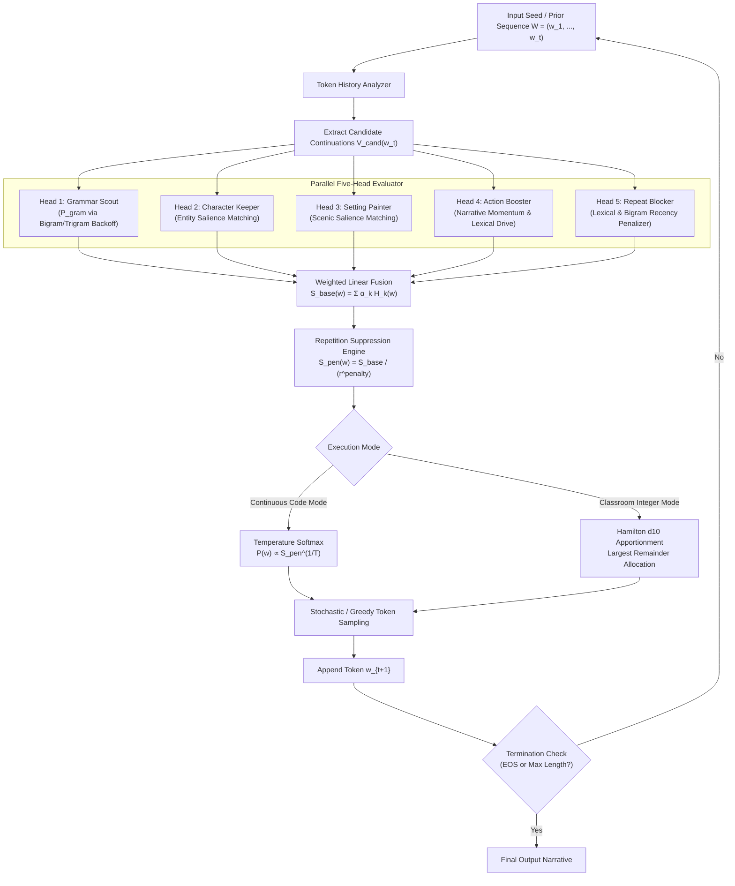

# System Architecture Specification

## 1. Architectural Philosophy

The Five-Head Story-Generation System is designed as an **inspectable, glass-box NLP architecture**. Unlike deep transformer-based language models whose billions of parameters obscure how individual token probabilities are shaped, this system decomposes autoregressive generation into five explicit, interpretable forces:

$$\text{Next-Token Distribution} = f(H_1, H_2, H_3, H_4, H_5, \text{History}, T)$$

Every intermediate computation—from raw n-gram transition frequencies to context matching, repetition suppression, and temperature scaling—is accessible to both young learners and researchers.

---

## 2. End-to-End Generation Pipeline

The generation pipeline follows a strict autoregressive cycle:



---

## 3. Subsystem Breakdown

### 3.1 Tokenization & Corpus Processing (`src/five_head_nlp/tokenization/`)
- **Word-Level Tokenizer**: Splits texts on whitespace and isolates punctuation marks (`.`, `,`, `!`, `?`) as distinct individual tokens.
- **Case Normalization**: Lowercases all tokens to consolidate lexical counts while preserving character names via explicit entity registries.
- **Vocabulary Mapping**: Maps tokens to discrete integer IDs and back to strings.

### 3.2 N-Gram Transition Engine (`src/five_head_nlp/ngrams/`)
- **Sparse Transition Table**: Implemented via nested frequency tables (`dict[str, Counter[str]]`).
- **Trigram-Backoff Interpolation**:
  $$P_{\text{gram}}(w \mid w_{t-1}, w_t) = 0.65 \cdot P_{\text{tri}}(w \mid w_{t-1}, w_t) + 0.35 \cdot P_{\text{bi}}(w \mid w_t)$$
  When the trigram $(w_{t-1}, w_t)$ was never observed in training, the engine gracefully falls back purely to the bigram probability $P_{\text{bi}}(w \mid w_t)$.
- **Dead-End Recovery**: If a token has zero observed transitions (terminal or unseen token), the engine smoothly falls back to the corpus-level sentence-starter distribution or global unigram frequencies.

### 3.3 The Five Scoring Heads (`src/five_head_nlp/heads/`)
Each head implements a standardized interface:
```python
def score(candidate: str, context: GenerationContext) -> float:
    ...
```

1. **Head 1 (`GrammarScout`)**:
   - Continuous Mode: $H_1(w) = 10 \cdot P_{\text{gram}}(w)$
   - Integer Mode: $H_1(w) \in \{1, 2, 3, 4\}$ based on raw transition frequency buckets.
2. **Head 2 (`CharacterKeeper`)**:
   - Inspects the recent context window (default: last 8 tokens) for active characters (e.g., Milo, Pip, Zara).
   - Assigns high score ($8$ in continuous, $3$ in integer) to tokens in the active character's word bank; baseline score ($2$ in continuous, $1$ in integer) otherwise.
3. **Head 3 (`SettingPainter`)**:
   - Detects active setting cues (e.g., forest, castle, cave, garden).
   - Boosts associated environmental adjectives and nouns ($8$ vs. $2$).
4. **Head 4 (`ActionBooster`)**:
   - Encourages dynamic narrative flow by scoring verbs, movement words, and sensory terms ($9$ vs. $3$).
5. **Head 5 (`RepeatBlocker`)**:
   - Inspects recent history for unigram matches ($c_{\text{recent}}$) and immediate bigram matches ($I_{\text{bg}}$).
   - Continuous Mode: Fresh word = $9$, Repeated word = $0\dots 1$, Immediate self-loop = $0$.
   - Integer Mode: Fresh word = $4$, Repeated word = $0$.

### 3.4 Fusion & Repetition Engine (`src/five_head_nlp/decoding/`)
- **Base Weighted Fusion**:
  $$S_{\text{base}}(w) = \sum_{k=1}^5 \alpha_k H_k(w)$$
  Default weights: $\boldsymbol{\alpha} = [0.40, 0.15, 0.15, 0.10, 0.20]$.
- **Repetition Penalty**:
  $$S_{\text{pen}}(w) = \max\left(0.05, \frac{S_{\text{base}}(w)}{r^{2 \cdot I_{\text{bg}}(w) + c_{\text{recent}}(w)}}\right), \quad r = 1.8$$

### 3.5 Decoding Strategies (`src/five_head_nlp/decoding/`)
- **Greedy Decoding**: Selects $\arg\max_w S_{\text{pen}}(w)$.
- **Temperature-Scaled Softmax**: Converts penalized scores into a valid probability distribution over candidates:
  $$P(w) = \frac{\left(S_{\text{pen}}(w)\right)^{1/T}}{\sum_v \left(S_{\text{pen}}(v)\right)^{1/T}}$$
  Operates across user-selectable regimes: Focused ($T = 0.5$), Balanced ($T = 1.0$), High-Entropy ($T = 2.0$).
- **Hamilton d10 Apportionment**: Maps integer or continuous scores to discrete integer slices totaling exactly 10, simulating a physical 10-sided die roll.

### 3.6 Evaluation Suite (`src/five_head_nlp/evaluation/`)
- **Distinct-1 & Distinct-2**: Lexical diversity measuring the ratio of unique unigrams/bigrams to total generated tokens.
- **Type-Token Ratio (TTR)**: Vocabulary richness.
- **Seq-Rep-2**: Proportion of repetitive bigrams.
- **3-Gram Loop Rate**: Percentage of generated texts containing at least one repeated 3-token sequence.
- **Trigram Validity**: Percentage of generated trigrams attested in the ground-truth training corpus.
- **Thematic Coherence**: Ratio of emitted tokens aligned with active character and setting state.

---

## 4. Key Design Patterns & Interfaces

1. **Stateless Scoring Heads**: Heads maintain no internal mutable state during scoring; all state is passed via an immutable `GenerationContext` dataclass.
2. **Strategy Pattern for Decoding**: Decoding algorithms (`GreedyDecoder`, `TemperatureSampler`, `HamiltonD10Sampler`) share a unified `BaseDecoder` interface.
3. **Pluggable Evaluation Harness**: Metrics run over arbitrary batches of generated strings, outputting standardized pandas DataFrames and summary dictionaries.
