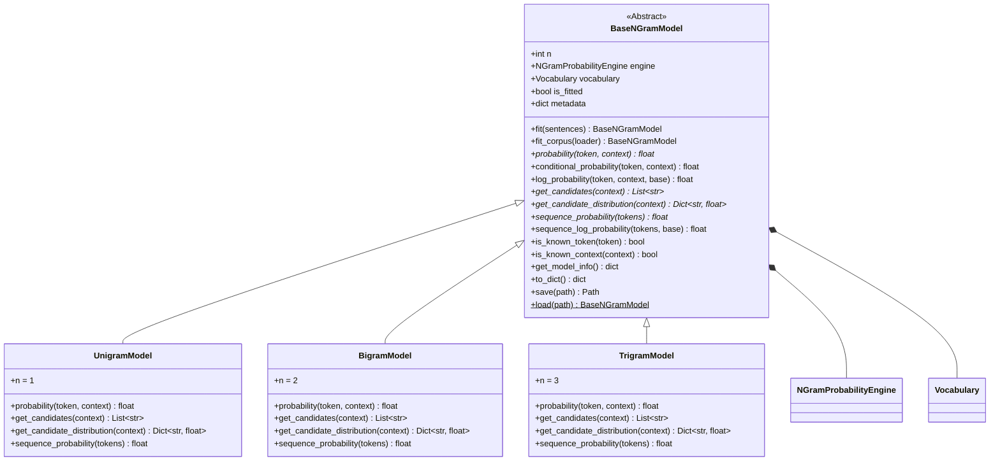

# Language Model Architecture Specification

## 1. Overview & Architectural Philosophy

Phase 3.2 implements an object-oriented, extensible language-model hierarchy for the Five-Head Story-Generation System. 

The architecture strictly decouples mathematical estimation from model orchestration:
- **Mathematical Estimation** is encapsulated inside `NGramProbabilityEngine` ([mle.py](file:///C:/Users/vasud/OneDrive/Desktop/NLP-GAME-PROJECT/src/five_head_nlp/probability/mle.py)), which computes empirical frequency tables, conditional probabilities, and joint sequence likelihoods.
- **Lexical Identification & Indexing** is managed by `Vocabulary` ([vocabulary.py](file:///C:/Users/vasud/OneDrive/Desktop/NLP-GAME-PROJECT/src/five_head_nlp/tokenization/vocabulary.py)), providing bidirectional token-to-ID mappings, deterministic vocabulary ordering, and lexical/punctuation categorization.
- **Model Orchestration & Interfaces** are unified by `BaseNGramModel` and specialized by `UnigramModel`, `BigramModel`, and `TrigramModel`.



---

## 2. Core Model Classes

### 2.1 BaseNGramModel (`src/five_head_nlp/models/base_ngram.py`)
Abstract base class defining the standardized public interface for all autoregressive N-gram models:
- Validates model order $N \ge 1$.
- Tracks training lifecycle via `is_fitted` and `metadata`.
- Reuses `NGramProbabilityEngine` with `include_lower_orders=True`, ensuring lower-order counts are instantly available for fallbacks and subsequent smoothing.
- Provides polymorphic `load(path)` and `save(path)` using safe JSON persistence.

### 2.2 UnigramModel (`src/five_head_nlp/models/unigram.py`)
First-order ($N=1$) language model assuming token independence:
$$P(w) = \frac{C(w)}{N_{\text{total}}}$$
- **Context Handling**: Strictly context-independent; any passed context is ignored.
- **Candidates**: Returns all unique tokens in the vocabulary ordered deterministically (descending frequency, then alphabetical).
- **Candidate Distribution**: Returns empirical unigram probability distribution over all $|\mathcal{V}| = 120$ tokens, summing to exactly $1.0$.
- **Sequence Probability**:
  $$P(w_1, \dots, w_m) = \prod_{i=1}^m P(w_i)$$

### 2.3 BigramModel (`src/five_head_nlp/models/bigram.py`)
Second-order ($N=2$) language model conditioned on the single preceding token:
$$P(w_i \mid w_{i-1}) = \frac{C(w_{i-1}, w_i)}{C(w_{i-1})} = \frac{C(w_{i-1}, w_i)}{\sum_{v \in \mathcal{V}} C(w_{i-1}, v)}$$
- **Context Handling**: Accepts `w_{i-1}` as string or 1-tuple. If context is empty/None, gracefully falls back to unigram probability $P(w)$.
- **Candidates**: Returns tokens observed following `w_{i-1}` within sentences.
- **Sentence Boundary Isolation**: The period `.` has 0 outgoing transitions ($C(., \cdot) = 0$). Candidate list is `[]` and candidate distribution is `{}`.
- **Sequence Probability**:
  $$P(w_1, \dots, w_m) = P(w_1) \prod_{i=2}^m P(w_i \mid w_{i-1})$$

### 2.4 TrigramModel (`src/five_head_nlp/models/trigram.py`)
Third-order ($N=3$) language model conditioned on the two preceding tokens:
$$P(w_i \mid w_{i-2}, w_{i-1}) = \frac{C(w_{i-2}, w_{i-1}, w_i)}{C(w_{i-2}, w_{i-1})} = \frac{C(w_{i-2}, w_{i-1}, w_i)}{\sum_{v \in \mathcal{V}} C(w_{i-2}, w_{i-1}, v)}$$
- **Context Handling**: Accepts `(w_{i-2}, w_{i-1})` as sequence or tuple. If length is 1, evaluates bigram probability; if length is 0, evaluates unigram probability.
- **Candidates**: Returns tokens observed following `(w_{i-2}, w_{i-1})`.
- **Sequence Probability**:
  $$P(w_1, \dots, w_m) = P(w_1) \cdot P(w_2 \mid w_1) \prod_{i=3}^m P(w_i \mid w_{i-2}, w_{i-1})$$

---

## 3. Vocabulary Integration & Unknown Tokens

The model architecture strictly reuses `Vocabulary` ([vocabulary.py](file:///C:/Users/vasud/OneDrive/Desktop/NLP-GAME-PROJECT/src/five_head_nlp/tokenization/vocabulary.py)) without creating duplicate vocabularies:
- During `fit(sentences)`, `self.vocabulary = Vocabulary(sentences)` is created.
- The model provides explicit token validation methods:
  - `is_known_token(token)`: Checks membership in $\mathcal{V}$.
  - `is_known_context(context)`: Checks if the context was observed as a prefix in training.

### Unknown Token Protocol (Phase 3.2 Formalization):
1. **Unknown Tokens ($w \notin \mathcal{V}$)**:
   - For unsmoothed MLE models, $P(w \mid \text{context}) = 0.0$.
   - `log_probability` returns $-\infty$ (`-math.inf`).
   - `is_known_token(w)` returns `False`.
2. **Known Tokens with Unobserved Transitions ($w \in \mathcal{V}$, but $C(\text{context}, w) = 0$)**:
   - $P(w \mid \text{context}) = 0.0$.
   - `is_known_token(w)` returns `True`.
3. **Unknown Context**:
   - If context was never observed ($C(\text{context}) = 0$):
     - `get_candidates(context)` returns `[]`.
     - `get_candidate_distribution(context)` returns `{}`.
     - `is_known_context(context)` returns `False`.
4. **Corpus Integrity Preservation**:
   - No artificial `<UNK>` token is injected into the raw story corpus or training sentences.
   - Smoothing, backoff, and unknown-token probability mass redistributions are formally deferred to Phase 3.3.

---

## 4. Safe Model Serialization Schema

Models are persisted as human-readable, safe JSON files (avoiding pickle vulnerabilities).

### JSON Schema Structure:
```json
{
  "model_type": "BigramModel",
  "order": 2,
  "metadata": {
    "model_type": "BigramModel",
    "order": 2,
    "trained_at_utc": "2026-11-23T17:15:00.000000+00:00",
    "sentence_count": 34,
    "total_tokens": 415,
    "vocabulary_size": 120,
    "lexical_vocabulary_size": 119
  },
  "vocabulary": {
    "vocabulary_size": 120,
    "total_token_occurrences": 415,
    "full_vocabulary": ["the", ".", "milo", "pip", "..."],
    "token_frequencies": {"the": 63, ".": 34, "...": 1}
  },
  "engine": {
    "n": 2,
    "include_lower_orders": true,
    "is_fitted": true,
    "total_tokens": 415,
    "vocabulary_size": 120,
    "total_ngrams": {"1": 415, "2": 381},
    "ngram_counts": {
      "1": [{"tokens": ["the"], "count": 63}, ...],
      "2": [{"tokens": ["crystal", "castle"], "count": 6}, ...]
    }
  }
}
```

### Serialization Verification:
- Models saved under `experiments/models/`:
  - `unigrammodel_corpus.json`
  - `bigrammodel_corpus.json`
  - `trigrammodel_corpus.json`
- Verification tests confirm that reloading from disk restores:
  - Exact order, metadata, vocabulary, and counters.
  - 100% identical conditional probabilities, candidate lists, candidate distributions, and sequence joint likelihoods.
