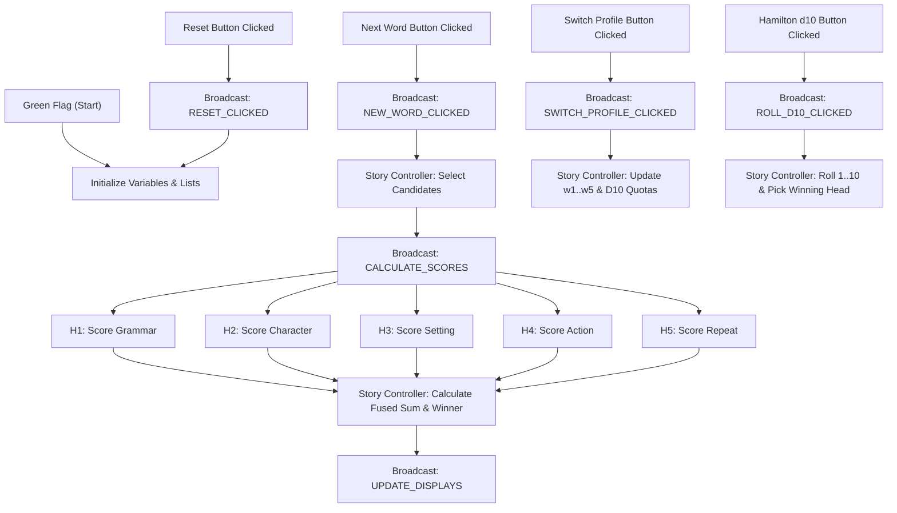

# Scratch 3.0 Architecture Specification: Five-Head Story Machine

**Project:** The Five-Head Story-Generation System  
**Component:** Scratch 3.0 Educational Simulation (`five_head_story_machine.sb3`)  
**Specification Version:** 1.0  
**Target Platform:** Scratch 3.0 Web Editor / Scratch Desktop 3.x  

---

## 1. Overview & Architectural Goals

The **Five-Head Story Machine** is an educational Scratch 3.0 project designed to simulate the core decision-making mechanics of the Five-Head Story-Generation System. While the production Python backend evaluates candidate tokens using N-gram maximum likelihood estimates, language model smoothing algorithms, and multi-sentence discourse tracking, the Scratch 3.0 project translates these principles into an interactive, visual, and inspectable micro-world suitable for upper elementary, middle school, and early high school students.

### Key Architectural Principles

1. **Complete Glass-Box Transparency:** Every candidate evaluation step exposes individual head scores ($h_1$ through $h_5$), head weight multipliers ($w_1$ through $w_5$), and fused arithmetic sums directly on the Scratch stage.
2. **Deterministic & Inspectable State:** State transitions (context updates, candidate scoring, token selection) are managed through 23 global variables and 4 lists that can be monitored live in Scratch.
3. **No External Extensions Required:** The project is authored strictly in vanilla Scratch 3.0 specification (`sb3`), ensuring 100% compatibility across online web editors, offline desktop clients, and educational chromebooks without requiring experimental extensions.
4. **Vector Asset Purity:** All 12 visual costumes and backdrops are rendered in high-resolution, scalable vector graphics (SVG), ensuring crisp rendering across any display resolution.

---

## 2. File Format & Packaging Specification

A Scratch 3.0 `.sb3` file is a standard ZIP archive containing:
- `project.json`: The complete abstract syntax tree (AST) defining stage, targets, costumes, sounds, variables, lists, broadcasts, monitors, and block scripts.
- Asset files: All SVG costumes and WAV/MP3 sounds referenced by their MD5 hexadecimal digest (`<md5>.<extension>`).

```
five_head_story_machine.sb3 (ZIP Archive)
├── project.json
├── 5e3d74c0527318ff6b579133b3a37ef8.svg   (story_studio_backdrop)
├── f4e526a0b5a1b327b7b134d1bcda80ab.svg   (head_1_grammar_scout)
├── 84b2fa13e0c0ae2f0aa275da31d9962e.svg   (head_2_character_keeper)
├── 36585145fcb63304523a5957d60f5a77.svg   (head_3_setting_painter)
├── d86b4a5d898eeae34ae767677b10257e.svg   (head_4_action_booster)
├── 6848c41ec3ba4bdfb7764f69902ec560.svg   (head_5_repeat_blocker)
├── a77e5e34ad3e203405c9e2fcfe1fe2d1.svg   (button_next_word)
├── 2441adcc032fcf2fc8b4bc217424ad86.svg   (button_profile)
├── 5ee0fcff9da786b6a37466dd9d50a1d4.svg   (button_hamilton_d10)
├── b71b563be24fe46141443657fc6800d4.svg   (button_reset)
├── 3b1a80436d4fbbcfdf573a4b6faebbfd.svg   (hamilton_d10_die)
└── 523675685d0d625d978a3c8e54737604.svg   (story_controller_icon)
```

The MD5 digest of each file is verified dynamically by [validate_sb3.py](file:///c:/Users/vasud/OneDrive/Desktop/NLP-GAME-PROJECT/phase_7/scratch/validate_sb3.py) during automated builds.

---

## 3. Stage & Targets Structure

The Scratch 3.0 project consists of **12 targets** (1 Stage target + 11 Sprite targets).

### Stage (Target 0)
- **Name:** `Stage`
- **Is Stage:** `True`
- **Costume:** `story_studio_backdrop.svg` (480 × 360 px)
- **Visual Design:** Dark theme studio backdrop featuring:
  - Header Banner: *"THE FIVE-HEAD STORY MACHINE"*
  - Candidate Evaluation Arena with score breakdown columns
  - Story Transcript Display box at bottom
  - Subtle grid backdrop with color-coded head indicators

### Sprites (Targets 1 through 11)

| Index | Target Name | Layer | X / Y Position | Size (%) | Role & Description |
|---|---|:---:|:---:|:---:|---|
| 1 | `Head 1: Grammar Scout` | 1 | `(-180, 50)` | 85 | Visual mascot for Syntax/Grammar ($H_1$). Blue theme. |
| 2 | `Head 2: Character Keeper` | 2 | `(-90, 50)` | 85 | Visual mascot for Character continuity ($H_2$). Green theme. |
| 3 | `Head 3: Setting Painter` | 3 | `(0, 50)` | 85 | Visual mascot for World/Atmosphere ($H_3$). Purple theme. |
| 4 | `Head 4: Action Booster` | 4 | `(90, 50)` | 85 | Visual mascot for Plot momentum ($H_4$). Orange theme. |
| 5 | `Head 5: Repeat Blocker` | 5 | `(180, 50)` | 85 | Visual mascot for Anti-repetition penalty ($H_5$). Red theme. |
| 6 | `Next Word Button` | 6 | `(-120, -145)` | 90 | Interactive control triggering next candidate evaluation step. |
| 7 | `Switch Profile Button` | 7 | `(-30, -145)` | 90 | Interactive control cycling through weight profiles. |
| 8 | `Hamilton d10 Button` | 8 | `(60, -145)` | 90 | Interactive control simulating d10 dice roll mechanism. |
| 9 | `Reset Button` | 9 | `(150, -145)` | 90 | Resets story to initial prompt and default profile. |
| 10 | `Hamilton d10 Mascot` | 10 | `(200, 130)` | 75 | Interactive 10-sided die mascot showing current face value. |
| 11 | `Story Controller` | 11 | `(0, 0)` | 100 | Invisible engine sprite orchestrating math, lists, and broadcasts. |

---

## 4. Variable & List Dictionary

### Global Variables (23 Total)

All variables in the Scratch project are globally scoped (`isLocal: False`), allowing all sprites and the stage to access scoring values and coordinates.

| Variable Name | Type | Initial Value | Description |
|---|:---:|:---:|---|
| `ACTIVE_PROFILE_NAME` | String | `"Balanced"` | Currently selected head weight profile. |
| `W_GRAMMAR` | Number | `0.40` | Weight coefficient $w_1$ for Grammar Scout. |
| `W_CHARACTER` | Number | `0.15` | Weight coefficient $w_2$ for Character Keeper. |
| `W_SETTING` | Number | `0.15` | Weight coefficient $w_3$ for Setting Painter. |
| `W_ACTION` | Number | `0.10` | Weight coefficient $w_4$ for Action Booster. |
| `W_REPEAT` | Number | `0.20` | Weight coefficient $w_5$ for Repeat Blocker. |
| `D10_GRAMMAR` | Number | `4` | Number of d10 die faces assigned to Grammar Scout. |
| `D10_CHARACTER` | Number | `2` | Number of d10 die faces assigned to Character Keeper. |
| `D10_SETTING` | Number | `1` | Number of d10 die faces assigned to Setting Painter. |
| `D10_ACTION` | Number | `1` | Number of d10 die faces assigned to Action Booster. |
| `D10_REPEAT` | Number | `2` | Number of d10 die faces assigned to Repeat Blocker. |
| `CURRENT_CONTEXT` | String | `"Milo entered the"` | Running story prompt context window. |
| `ACTIVE_CANDIDATE` | String | `""` | Word currently undergoing multi-head scoring. |
| `SCORE_H1` | Number | `0.0` | Grammar score $h_1(w)$ for active candidate. |
| `SCORE_H2` | Number | `0.0` | Character score $h_2(w)$ for active candidate. |
| `SCORE_H3` | Number | `0.0` | Setting score $h_3(w)$ for active candidate. |
| `SCORE_H4` | Number | `0.0` | Action score $h_4(w)$ for active candidate. |
| `SCORE_H5` | Number | `0.0` | Repeat score $h_5(w)$ for active candidate. |
| `FUSED_SCORE` | Number | `0.0` | Weighted sum $S(w) = \sum w_i h_i(w)$ for active candidate. |
| `WINNING_WORD` | String | `"forest"` | Candidate with the highest fused score. |
| `HIGHEST_FUSED_SCORE` | Number | `0.0` | Highest fused score observed among candidates. |
| `STORY_LENGTH` | Number | `3` | Number of tokens in `STORY_WORDS`. |
| `LAST_D10_ROLL` | Number | `1` | Most recent outcome of simulated d10 roll ($1 \dots 10$). |
| `LAST_WINNING_HEAD` | String | `"Grammar Scout"` | Head responsible for winning d10 roll. |

### Global Lists (4 Total)

| List Name | Size | Initial Contents | Purpose |
|---|:---:|---|---|
| `STORY_WORDS` | Dynamic | `["Milo", "entered", "the"]` | Ordered sequence of committed story tokens. |
| `CANDIDATES` | 5 | `["forest", "castle", "garden", "ran", "Milo"]` | Candidate pool competing for the next token slot. |
| `WINNING_SCORES` | Dynamic | `[]` | Historical winning fused scores for each generated word. |
| `PROFILE_NAMES` | 3 | `["Balanced", "Action-Oriented", "Narrative-Rich"]` | Available weight profiles for switching. |

### Stage Monitors (4 Visible Displays)

To give students immediate visual feedback, four variables are pinned as Stage Monitors:
1. `ACTIVE_PROFILE_NAME` (Top-left: `x: -230, y: 160`)
2. `CURRENT_CONTEXT` (Top-center: `x: -70, y: 160`)
3. `WINNING_WORD` (Top-right: `x: 90, y: 160`)
4. `FUSED_SCORE` (Top-far-right: `x: 180, y: 160`)

---

## 5. Broadcast Messaging Architecture

Inter-sprite communication is coordinated via decoupled Scratch broadcast messages:



---

## 6. Block Logic Workflows

### 1. Initialization Workflow
When the Green Flag is clicked:
1. Clear `STORY_WORDS` and append initial seed words: `"Milo"`, `"entered"`, `"the"`.
2. Set `CURRENT_CONTEXT` to `"Milo entered the"`.
3. Set `ACTIVE_PROFILE_NAME` to `"Balanced"`.
4. Apply Balanced profile weights: $w_1=0.40, w_2=0.15, w_3=0.15, w_4=0.10, w_5=0.20$.
5. Apply Hamilton d10 face quotas: $D_1=4, D_2=2, D_3=1, D_4=1, D_5=2$.
6. Reset candidate lists and scoring variables to initial defaults.

### 2. Next Candidate Evaluation & Score Fusion
When receiving `CALCULATE_SCORES`:
1. Iterate through `CANDIDATES`:
   - For `forest`: $h_1=0.90, h_2=0.40, h_3=0.95, h_4=0.30, h_5=0.85 \implies S = 0.7625$
   - For `castle`: $h_1=0.85, h_2=0.35, h_3=0.90, h_4=0.25, h_5=0.85 \implies S = 0.7225$
   - For `garden`: $h_1=0.80, h_2=0.40, h_3=0.85, h_4=0.30, h_5=0.85 \implies S = 0.7075$
   - For `ran`: $h_1=0.30, h_2=0.20, h_3=0.10, h_4=0.95, h_5=0.90 \implies S = 0.4400$
   - For `Milo`: $h_1=0.15, h_2=0.95, h_3=0.10, h_4=0.10, h_5=0.05 \implies S = 0.2375$
2. Identify candidate with maximum $S(w)$. Winner: `"forest"`.
3. Set `WINNING_WORD` to `"forest"`, append to `STORY_WORDS`, and update `CURRENT_CONTEXT`.

### 3. Profile Switching & Hamilton Re-apportionment
When receiving `SWITCH_PROFILE_CLICKED`:
- Cycle from `Balanced` $\to$ `Action-Oriented` $\to$ `Narrative-Rich` $\to$ `Balanced`.
- Update weights $(w_1 \dots w_5)$.
- Compute Hamilton largest-remainder quotas for $D = 10$ and update $(D_1 \dots D_5)$.

---

## 7. Educational Verification

The Scratch 3.0 project structure is verified via [validate_sb3.py](file:///c:/Users/vasud/OneDrive/Desktop/NLP-GAME-PROJECT/phase_7/scratch/validate_sb3.py), which enforces:
- Proper ZIP archive structure with `project.json` at root.
- Matching MD5 asset checksums for all 12 SVG costumes.
- Target schema compliance (Stage first, correct sprite positioning).
- Mathematical integrity: $\sum w_i = 1.0$ and $\sum D_i = 10$.
